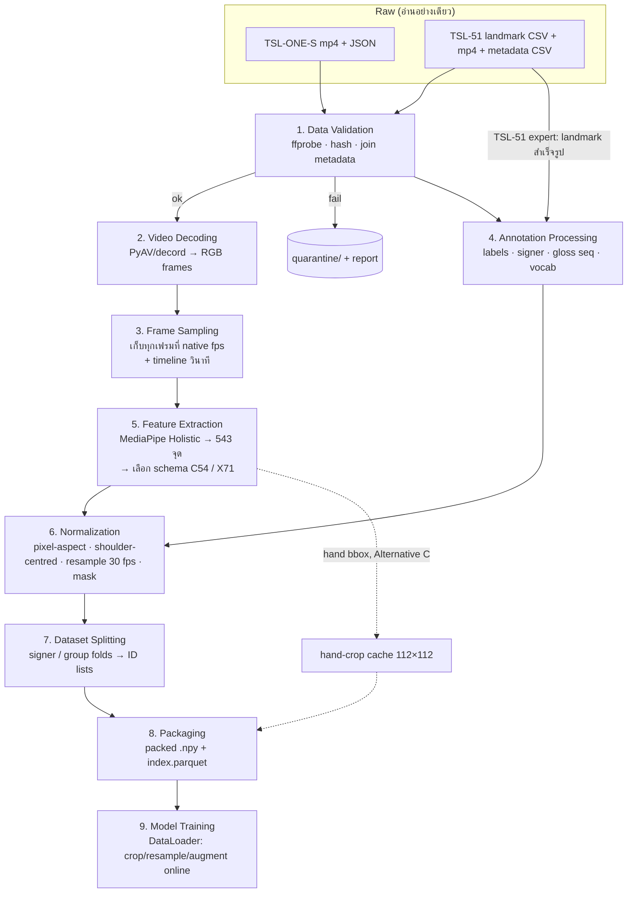

# Dataset Engineering & Data Pipeline Design: Sign2Say

> จัดทำตาม `Dataset&DataPipeline.md` · 8 พ.ย. 2026
> อิงกับ Architecture ที่เลือกใน [Technical_Design_Sign2Say.md](Technical_Design_Sign2Say.md) (Landmark-based S2S-LTR เป็นหลัก, Hybrid hand-crop RGB เป็นทางเลือก, cascade gloss → ข้อความไทย)
>
> **ป้ายกำกับ**
> - ✅ **ตรวจจากไฟล์ในเครื่อง** = นับหรืออ่านจากไฟล์จริงในโปรเจกต์ (8 พ.ย. 2026)
> - 📄 **จากเอกสารของ dataset/บทความ** = README หรือบทความต้นฉบับระบุไว้ (ยังไม่ได้ตรวจกับไฟล์ ถ้าไม่มี ✅ คู่กัน)
> - 📚 **จากบทเรียน** = แนวคิดจากเอกสารวิชาใน Knowledge Base
> - 🛠 **ข้อเสนอการออกแบบ** = การตัดสินใจของเอกสารนี้
> - ❓ **ยังไม่รู้** = ต้องตรวจเพิ่มก่อนใช้

---

## 0. สรุปสิ่งที่ต้องรู้ก่อน (อ่านส่วนนี้ก่อน)

| # | ข้อค้นพบจากไฟล์จริง (✅) | ผลต่อการออกแบบ |
|---|---|---|
| 1 | TSL-ONE-S มี **แค่ mp4 4,152 ไฟล์ + JSON split** ในเครื่อง ไม่มี skeleton CSV | ต้องสกัด landmark เองด้วย MediaPipe → ได้ schema เดียวกับ TSL-51 |
| 2 | Split เดิมของ TSL-ONE-S ไม่ signer-independent (ทุก signer อยู่ใน train) | ใช้ `splits/tsl_one_s_signer_indep_fold{0-9}.json` ที่สร้างไว้แล้ว |
| 3 | gloss ของ TSL-ONE-S เป็น**ภาษาอังกฤษ** (`Mom`, `Chicken egg`) ส่วน TSL-51 เป็น**ภาษาไทย** + variant (`ฉัน_var_1`) → **ชื่อตรงกัน 0 คำ** | ห้ามรวม label โดยเทียบชื่อ; คำที่ความหมายตรงกันมีราว 6–8 คำ (เช่น Mom/แม่, Egg/ไข่) และท่าอาจต่างกันตามภูมิภาค → ถือเป็น **label space แยกกัน** |
| 4 | TSL-51 expert: แถว `null_act` 448 แถวมี `sign_clean` ว่าง | อ่าน label จาก `sign_id` ไม่ใช่ `sign_clean` |
| 5 | TSL-51: `t_ms` ในไฟล์ landmark **ไม่ใช่เวลาในวิดีโอ** (301 เฟรมที่ 30 fps = 10 วินาที แต่ `t_ms` ยาว 12.4 วินาทีและห่างไม่สม่ำเสมอ) | คำนวณเวลาจาก `frame / fps` เท่านั้น |
| 6 | TSL-51: README บอกว่าค่าที่หายเป็น `NaN` แต่ไฟล์จริงเป็น**ช่องว่าง** (`,,`) | loader ต้องแปลงช่องว่างเป็น missing |
| 7 | TSL-51: path ใน metadata (`expert_primary_01/02`) ไม่ตรงกับชื่อโฟลเดอร์ที่แตก zip (`landmarks/landmarks`, `landmarks/landmarks 2`) | join ด้วย **ชื่อไฟล์** ผ่านตาราง mapping (ดู §2 stage 1) |
| 8 | TSL-51 มีไฟล์ที่**ไม่อยู่ใน metadata**: expert 9,577 ไฟล์ (คำนอก 51 คำ เช่น มะม่วง, อ่าน, พัก, ไม่), user_sign 91, user_sentence 21 | ใช้ metadata เป็นแหล่งความจริง; ไฟล์เกินย้ายไป quarantine |
| 9 | TSL-51 ประโยค: ไม่มีคำแปลภาษาไทยรายประโยค มีแค่ลำดับ gloss (62 แบบที่ไม่ซ้ำ) และตารางโครงสร้าง 13 กลุ่มใน README | **ต้องเขียนคำแปลไทยเอง** ก่อนประเมิน gloss → text (แก้ข้อความใน TDD แล้ว) |
| 10 | TSL-51 expert มี augmentation สำเร็จรูป 43,970 ชุด (จาก 1,155 ต้นฉบับ) รวม 1,342 ชุดที่มี **hflip** | ห้ามให้ copy ของคลิปเดียวกันอยู่คนละ split; ระวัง hflip สลับมือ |

---

## 1. Dataset Investigation

### 1.1 Dataset ภาษามือไทย (ใช้จริง)

| | **TSL-ONE-S** | **TSL-51 expert** | **TSL-51 user_sign** | **TSL-51 user_sentence** | **One-Stage-TFS** |
|---|---|---|---|---|---|
| ภาษามือ | TSL (หลายภูมิภาค) | TSL | TSL | TSL | ตัวสะกดนิ้วไทย |
| จำนวน | 4,152 mp4 ✅ | 1,155 ต้นฉบับ → 45,125 หลัง augment ✅ | 547 ✅ (+91 ไฟล์นอก metadata) | 252 ✅ (+21 นอก metadata) | 5,750 / 1,405 / 300 ภาพ ✅ |
| ผู้แสดง | 29 (deaf 13, hearing 16, ถนัดขวาทุกคน 📄) | expert_01 481, expert_02 552, web 122 ต้นฉบับ ✅ | 1 คน (`primary_collection_01`) ✅ | 1 คน (คนเดียวกับ user_sign) ✅ | ❓ |
| คำ/ประโยค | 184 gloss, 8 หมวด, 16–27 คลิป/gloss ✅ | 52 `sign_id` (51 ท่า + `null_act`) ✅, 11–43 ต้นฉบับ/คลาส ✅ | 52 `sign_id` ✅, 10–23 คลิป/คลาส ✅ | 76 แม่แบบ, 62 ลำดับ gloss ที่ไม่ซ้ำ, ใช้ 31 `sign_id`, ยาว 3–6 ท่า (3: 159, 4: 81, 5: 6, 6: 6 คลิป) ✅ | 15 คลาส |
| Annotation | label ต่อคลิป, signer ใน `video_id` ✅ | `sign_id`, `original_video_id`, `augmentation_type`, signer ✅ | `sign_id`, `subset` (test/calib — README ให้ข้ามได้) ✅ | ลำดับ `sign_id` ใน `sentence_id`, `with_space`/`no_space` ✅ | bbox Pascal VOC ✅ |
| Resolution / FPS | 1280×720, 29.97 fps (📄; ยังไม่ได้ตรวจทุกไฟล์ ❓) | primary 1920×1080 และ ~1,180×950 ที่ 30 fps; web 1280×720@25, 600×600@50 ✅ | 640×480, 30 fps ✅ | 640×480, 30 fps ✅ | 1080×720 |
| ความยาว | เฉลี่ย 1.94 s, 0.53–6.47 s 📄 | median 69 เฟรม (1–235) ✅; มี 2 คลิป < 15 เฟรม | 60–121 เฟรม ✅ | 180–541 เฟรม (median 270) ✅ | ภาพนิ่ง |
| ข้อมูลที่ให้ | วิดีโอ (crop ตัวคนแล้ว 📄) | **landmark CSV เท่านั้น** (ไม่มีวิดีโอ) ✅ | วิดีโอ + landmark ✅ | วิดีโอ + landmark ✅ | ภาพ + XML |
| License | dataset CC-NC, บทความ CC BY 4.0 📄 | CC BY-NC-SA 4.0; ส่วน web-scraped อาจติดลิขสิทธิ์ต้นทาง 📄 | CC BY-NC-SA 4.0 📄 | CC BY-NC-SA 4.0 📄 | ❓ |
| วิธีดาวน์โหลด | วิดีโอ: ขอผ่านฟอร์ม [tsl-one.github.io](https://tsl-one.github.io/) 📄 | Hugging Face `Namonpas/thai-sign-language-tsl51` (`load_dataset` หรือโหลดไฟล์ตรง) 📄 | เหมือนกัน | เหมือนกัน | มีในเครื่องแล้ว |
| ISLR | 🟢 หลัก | 🟢 (train) | 🟢 (external test) | – | 🟢 (ตัวสะกด, นอกขอบเขตหลัก) |
| CSLR | ❌ | ✅ ใช้สร้างประโยคสังเคราะห์ | ✅ ใช้สร้างประโยคสังเคราะห์ | 🟡 คนเดียว | ❌ |
| SLT | ❌ | ❌ | ❌ | 🟡 หลังเขียนคำแปลไทยเอง | ❌ |

### 1.2 Dataset ภายนอก (ไม่ใช่ TSL)

| Dataset | ใช้ทำอะไร | เงื่อนไข |
|---|---|---|
| Google ISLR (Kaggle 2023, ASL, MediaPipe landmark) | pretrain encoder แบบ cross-lingual (ทดลอง RQ4 ใน Experiment Design) | ต้องตรวจ Kaggle rules ❓; รายงานผล TSL แยกเสมอ ห้ามรายงานผล ASL เป็นผล TSL |
| WLASL / AUTSL | ไม่ใช้ในแผนหลัก | ต้องสกัด landmark เอง, license ❓ |
| PHOENIX-2014T | ทดสอบโค้ด CTC/WER ว่าทำงานถูก (sanity check) ถ้ามีเวลา | non-commercial; ไม่ใช่ผลของโปรเจกต์ |

### 1.3 บทบาทของแต่ละ dataset (🛠)

| บทบาท | ISLR (คำเดี่ยว) | CSLR (ประโยค) | Gloss → Text |
|---|---|---|---|
| **Train** | TSL-ONE-S (train ของแต่ละ fold); TSL-51 expert ต้นฉบับ (+ augment online) | ประโยคสังเคราะห์จากคำเดี่ยวของ TSL-51 + user_sentence ส่วน train | คู่ gloss → ไทยที่เขียนเพิ่ม (ใช้เป็นตัวอย่าง few-shot หรือกฎ) |
| **Validation** | TSL-ONE-S val ของแต่ละ fold | user_sentence ส่วน val | ส่วน val ของคู่ที่เขียน |
| **Test (หลัก)** | TSL-ONE-S test ของแต่ละ fold (signer-independent) | user_sentence ส่วน test (signer-dependent, ระบุชัด) | ส่วน test ของคู่ที่เขียน |
| **External evaluation** | (ก) TSL-51 user_sign: ผู้แสดงใหม่ + กล้อง 640×480 สำหรับโมเดลคำศัพท์ TSL-51; (ข) ชุด webcam ที่บันทึกเอง (§4.3) | ประโยคที่บันทึกเองจากผู้แสดงคนอื่น (ถ้าเก็บได้) | ผู้ใช้ภาษามือตรวจคำแปล |

> ⚠️ TSL-ONE-S กับ TSL-51 มีคำศัพท์แทบไม่ซ้ำกัน การ "รวม dataset" จึงหมายถึง **ฝึก encoder ร่วมกันโดยมี head แยกตาม label space** (หรือ head เดียว 184 + 52 คลาส) ไม่ใช่การเพิ่มตัวอย่างให้คลาสเดิม — ระบุไว้ใน Experiment Design (RQ ด้าน dataset)

---

## 2. Data Pipeline Design



หลักของ pipeline (🛠):
- **ทำงานหนักครั้งเดียว ทำงานเบาทุก epoch**: decode + MediaPipe ทำ offline ครั้งเดียว ส่วน resample/augment ทำ online ใน DataLoader
- **แยก "ข้อมูล" กับ "split"**: feature เก็บชุดเดียว ส่วน split เป็นแค่รายการ `clip_id` → 10 fold ไม่ต้องคัดลอก feature 10 ชุด
- **ทุก stage เขียน manifest** (input hash, config, version ของเครื่องมือ) เพื่อให้รันซ้ำได้ผลเดิม

| # | Stage | Input | Output | Format | เครื่องมือ | หมายเหตุ / failure points |
|---|---|---|---|---|---|---|
| 1 | **Data Validation** | ไฟล์ raw + metadata CSV/JSON | `metadata/clips.csv` + `reports/validation.json` + `quarantine/` | CSV, JSON | `ffprobe` (ยังไม่ได้ติดตั้งในเครื่อง ✅), Python `csv`/`hashlib`, pandas | ตรวจ: เปิดไฟล์ได้, fps/ขนาด/จำนวนเฟรม, ซ้ำด้วย SHA-1, ทุกแถว metadata มีไฟล์, ไฟล์เกิน metadata; **TSL-51 join ด้วยชื่อไฟล์ผ่าน mapping**: `expert_primary_01 → landmarks/landmarks/`, `expert_primary_02 → landmarks/landmarks 2/`, `expert_scraped → expert_scraped.zip` (ตรวจแล้วตรง 100% ✅) |
| 2 | **Video Decoding** | mp4 | ลำดับเฟรม RGB `uint8 [T,H,W,3]` (ในหน่วยความจำ ไม่เขียนลงดิสก์) | – | **PyAV** หรือ decord; OpenCV ใช้ได้ (📚 Ch13 ใช้ `cv2.VideoCapture`) แต่ต้องแปลง BGR → RGB | OpenCV คืนค่า fps จาก container ซึ่งอาจปัด (29.97 → 30); ใช้ timestamp ของ PyAV ถ้าต่างกัน |
| 3 | **Frame Sampling** | เฟรมทั้งหมด | เฟรมที่ native fps + `t_sec` ของแต่ละเฟรม | – | – | 🛠 **ไม่ลดเฟรมก่อน MediaPipe** เพราะ tracking ของ MediaPipe ต้องการเฟรมติดกัน และ landmark เก็บทุกเฟรมก็เล็กอยู่แล้ว; การกำหนดจำนวนเฟรมให้โมเดลทำที่ stage 9 |
| 4 | **Annotation Processing** | JSON TSL-ONE-S, metadata TSL-51 | `annotations/vocab_*.json`, `annotations/sentences.jsonl`, คอลัมน์ label ใน `clips.csv` | JSON, JSONL | Python | signer จาก `video_id.split("_")[0]` (TSL-ONE-S ✅); label TSL-51 จาก `sign_id`; gloss sequence จาก `sentence_id.split("__")` (คงข้อมูล variant) |
| 5 | **Feature Extraction** | เฟรม RGB | `features/landmarks/{schema}/{dataset}/{clip_id}.npz`: `xyz [T,N,3] float32`, `mask [T,N] bool`, `pose_vis [T,6]` | NPZ | **MediaPipe Holistic** config เดียวกับ TSL-51: `min_detection_confidence=0.5`, `min_tracking_confidence=0.5`, `model_complexity=1` 📄; บันทึกเวอร์ชัน mediapipe | ส่วนที่ช้าที่สุด (TSL-ONE-S ≈ 240K เฟรม); รันขนานแยกตามไฟล์; TSL-51 expert **ข้าม stage 2–5** (มี landmark อยู่แล้ว แต่ไม่มีวิดีโอให้สกัดใหม่) |
| 6 | **Data Normalization** | `xyz` + metadata (W, H, fps) | `xyz_norm [T',N,3]`, `mask [T',N]` ที่ 30 fps | NPZ | NumPy | ดู §3.1–3.5 |
| 7 | **Dataset Splitting** | `clips.csv` (signer, group) | `splits/{name}/fold{k}.json` = `{train:[clip_id], val:[…], test:[…]}` | JSON | `scripts/make_signer_split.py` (TSL-ONE-S มีแล้ว ✅) + สคริปต์เพิ่มสำหรับ TSL-51 | assert ไม่มี signer/group ซ้ำข้าม split |
| 8 | **Data Packaging** | NPZ ทุกคลิป | `packed/{schema}/{dataset}.npy` (ต่อทุกคลิปเป็นแถวเดียว `[ΣT, N, 4]`) + `packed/.../index.parquet` (`clip_id, offset, length`) | NPY (memmap), Parquet/CSV | NumPy, pandas | ข้อมูล landmark ทั้งหมดเล็ก (TSL-ONE-S ≈ 160 MB สำหรับ 54 จุด float32 ✅ คำนวณ) → โหลดเข้า RAM ได้ทั้งก้อน; ไม่จำเป็นต้องใช้ LMDB/WebDataset |
| 9 | **Model Training** | packed + split JSON | batch `[B,T,N,C]` + mask + label | PyTorch tensor | `torch.utils.data.Dataset` (📚 Ch13 สร้าง Dataset/DataLoader เอง) | resample/crop/augment/velocity คำนวณ online; augment เฉพาะ train |

---

## 3. Data Preprocessing Specification

### 3.1 Video length, FPS, resolution

| ประเด็น | ข้อมูลจริง | วิธีจัดการ (🛠) |
|---|---|---|
| FPS ไม่เท่ากัน | 29.97 (TSL-ONE-S), 30 (TSL-51 primary/user), 25 และ 50 (TSL-51 web) ✅ | สร้าง timeline เป็นวินาที `t = frame / fps` แล้ว **resample ทุก dataset เป็น 30 fps** ด้วย linear interpolation เฉพาะช่วงที่ mask = valid ทั้งสองข้าง; ห้ามใช้ `t_ms` ของ TSL-51 (เป็นเวลาประมวลผล ✅) |
| Resolution/aspect ratio ไม่เท่ากัน | 1280×720 (16:9), 640×480 (4:3), 600×600 (1:1), 1920×1080 ✅ | MediaPipe ให้ x, y เป็นสัดส่วน [0,1] ของกว้าง/สูง → **คูณกลับเป็นพิกเซล** (`x·W`, `y·H`) ก่อน normalize ไม่เช่นนั้นวิดีโอ 4:3 กับ 16:9 จะยืดคนละแบบ; z คูณด้วย W (README: z อยู่ใน scale เดียวกับ x 📄) |
| ความยาวคลิป (ISLR) | 0.53–6.47 s (TSL-ONE-S 📄), 60–121 เฟรม (user_sign ✅) | ตัดช่วงพักหัว/ท้ายเพิ่มเติมด้วยกฎ "มือต่ำกว่าระดับสะโพก" (แบบที่ TSL-ONE-S ใช้ตัดคลิป 📄) ถ้าคลิปยังมีช่วงพัก; แล้ว **resample ให้ T = 64** (📚 Ch13 ตัวอย่างโค้ดตัดที่ `max_frames=30` เฟรมแรก — ใช้แบบนั้นไม่ได้ เพราะคลิปเฉลี่ยราว 58 เฟรม การตัดเฟรมท้ายจะตัดท่าทิ้ง) |
| ความยาวประโยค (CSLR) | 180–541 เฟรม ✅ | **ไม่ resample ความยาว** (CTC ต้องการเวลาจริง); pad ใน batch + attention mask; จำกัดสูงสุด 600 เฟรม |

### 3.2 Missing frames, corrupted videos

| กรณี | ตรวจอย่างไร | จัดการ |
|---|---|---|
| วิดีโอเปิดไม่ได้ / 0 เฟรม | stage 1 | quarantine + บันทึกเหตุผล |
| คลิปสั้นผิดปกติ | `n_frames < 15` (TSL-51 expert มี 2 คลิป ✅) | quarantine; ตรวจด้วยตาก่อนตัดสินใจ |
| มือหาย (MediaPipe ไม่เจอ) | `mask` | **ไม่ใช่ความผิดพลาดเสมอไป**: ตัวอย่าง 200 คลิปของ user_sign มือซ้ายหาย 69% ของเฟรม มือขวา 40% ✅ ซึ่งส่วนใหญ่เป็นท่ามือเดียวหรือช่วงพัก → เก็บ mask ไว้เป็น feature; interpolate เฉพาะช่องว่าง ≤ 5 เฟรมที่มีจุดตรวจเจอทั้งสองฝั่ง; ส่วนที่เหลือเป็น 0 + mask = 0 |
| ลำตัวหาย (ไหล่) | `mask` ของไหล่ | ใช้ค่า scale จากเฟรมใกล้สุดที่เจอ; ถ้าไม่เจอทั้งคลิป → quarantine (normalize ไม่ได้) |
| มือสลับซ้าย-ขวา | ข้อมือ MediaPipe Hands ห่างจากข้อมือของ Pose เกินเกณฑ์ | สลับกลับโดยยึดข้อมือของ Pose 🛠 |
| เฟรมซ้ำ/กระโดด (VFR) | timestamp ของ PyAV ไม่สม่ำเสมอ | resample ตาม timestamp จริง |
| ไฟล์ที่ไม่อยู่ใน metadata | stage 1 | quarantine (ไม่ใช้ฝึก เพราะไม่รู้ label/ที่มาแน่ชัด) |

### 3.3 Variable-length sequences

- ISLR: resample คงที่ T = 64 → batch ขนาดเท่ากัน ไม่ต้อง pad (🛠 ทดลอง T = 32/64/96 ใน ablation)
- CSLR: **bucket by length** (จัดกลุ่มคลิปที่ยาวใกล้กันใน batch เดียว) + pad + `key_padding_mask` ของ Transformer + ส่ง `input_lengths` ให้ `nn.CTCLoss`
- เงื่อนไข CTC: ความยาวหลัง downsample ต้อง ≥ จำนวน gloss (+ จำนวนคู่ gloss ซ้ำติดกัน) — ประโยคยาวสุด 6 ท่า ≪ 90 เฟรมหลังลด ×2 ✅

### 3.4 Hand / Pose / Face extraction — schema

| Schema | จุด | ใช้กับ | ที่มา |
|---|---|---|---|
| **C54** (canonical) | pose 6 (index 11–16: ไหล่ ศอก ข้อมือ), face 6 (105, 70, 300, 334, 61, 291: คิ้ว 4 + มุมปาก 2), มือ 21 × 2 → 54 จุด = 162 ค่า | **ทุก dataset** (TSL-51 expert มีแค่ schema นี้) | 📄 README TSL-51; ✅ คอลัมน์ในไฟล์ = `frame`, `t_ms` + pose 6 × (x, y, z, vis, pres) + face 6 × 3 + มือ 42 × 3 = 176 คอลัมน์ |
| **X71** (extended, 🛠) | C54 + ริมฝีปาก 10 จุด (0, 17, 13, 14, 37, 267, 84, 314, 78, 308) + ตาบน/ล่าง 4 จุด (159, 145, 386, 374) + จมูก 1 + สะโพก 2 (pose 23, 24) → 71 จุด | TSL-ONE-S และ user ที่มีวิดีโอเท่านั้น (ablation ด้านสีหน้า) | ❓ ต้องตรวจ index กับแผนที่ face mesh ก่อนใช้จริง |
| S54 ของ TSL-ONE-S | หัว 5 + ลำตัว 7 (รวม neck) + มือ 42 | **ไม่ใช้** — แค่ชื่อ "54 จุด" ซ้ำกับ C54 แต่เป็นคนละชุดจุด | 📄 Fig. 12–14 ของบทความ |

> ⚠️ ทุกไฟล์ landmark ต้องมี `schema` อยู่ใน metadata ของไฟล์ — ห้ามอนุมานจากจำนวนจุด เพราะ C54 กับ S54 มี 54 จุดเท่ากัน

**Normalization ต่อเฟรม** (หลังแปลงเป็นพิกเซล):
1. จุดศูนย์กลาง = กึ่งกลางไหล่ซ้าย-ขวา; scale = ระยะไหล่ (median ทั้งคลิป เพื่อไม่ให้สั่น)
2. `p' = (p − center) / scale` สำหรับทุกจุด (ตำแหน่งมือเทียบลำตัว — ข้อมูล *location*)
3. เพิ่ม feature มือแบบ local: จุดมือลบข้อมือ หารขนาด bbox ของมือ (ข้อมูล *handshape*, แบบ SPOTER 📄)
4. Feature ต่อจุด: `[x, y, z, Δx, Δy, Δz, valid]` = 7 ช่อง (ตาม TDD §8.1)

### 3.5 Data augmentation (online, train เท่านั้น)

| ชนิด | การแปลง | ช่วงค่า 🛠 | หมายเหตุ |
|---|---|---|---|
| Spatial | หมุนในระนาบ, scale, เลื่อน, shear เล็กน้อย | ±10°, 0.9–1.1, ±0.1 scale ไหล่ | 📚 Pre-trained CNN & Augmentation (rotation/scale) แต่ทำบนพิกัดแทนภาพ — ถูกกว่ามาก |
| Temporal | เปลี่ยนความเร็ว (resample), ตัดหัว/ท้าย, drop เฟรมสุ่ม | 0.8–1.25×, crop 90–100%, drop ≤ 10% | ช่วงเดียวกับที่ TSL-51 ใช้ (`speed_0.70x`–`1.40x`, `tcrop_90pct` ✅) |
| Noise | Gaussian บนพิกัด | σ = 0.01 scale ไหล่ | จำลอง jitter ของ MediaPipe |
| Dropout ของส่วน | ปิดมือหนึ่งข้าง/หน้าเป็นช่วงสั้น (mask = 0) | p = 0.1 | ให้ทนต่อมือหาย — แนวคิดเดียวกับ Cutout 📚 แต่ทำในมิติของจุด |
| Horizontal flip | สะท้อน x **และสลับ lh ↔ rh** | **ปิดเป็นค่าเริ่มต้น** | ผู้แสดง TSL-ONE-S ถนัดขวาทุกคน 📄 → flip สร้างข้อมูลแบบที่ไม่มีใน test; เปิดเป็น ablation (จำลองผู้ใช้ถนัดซ้าย) |
| MixUp / CutMix | – | **ไม่ใช้** | 📚 ใช้กับภาพได้ดี แต่การผสมสองท่าภาษามือไม่ได้ท่าที่มีความหมาย |
| Augmentation สำเร็จรูปของ TSL-51 | 43,970 copy | **ใช้แค่ต้นฉบับ 1,155 คลิป + online augment** เป็นค่าเริ่มต้น; ใช้ copy สำเร็จรูปเป็น ablation | copy หลายชนิดเป็นการเปลี่ยนภาพ (blur, brightness) ก่อนสกัด landmark — มีประโยชน์จำลองผลต่อ MediaPipe ซึ่ง online augment ทำไม่ได้; ชื่อ `augmentation_type` ไม่สม่ำเสมอ (3,647 ค่า เพราะบางค่ามี prefix เช่น `01_1_blur_k3` ✅) → parse ด้วย suffix |
| CSLR: ประโยคสังเคราะห์ | ต่อ landmark ของคำเดี่ยว 3–6 คำตามแม่แบบไวยากรณ์ + ช่วงเปลี่ยนท่า (interpolate 5–10 เฟรม หรือแทรก `null_act`) | 🛠 | แก้ปัญหาประโยคจริงมีน้อย; ต้องรายงานผลบนประโยคจริงแยกเสมอ |

### 3.6 Label encoding, gloss tokenization, text tokenization

| สิ่งที่ encode | วิธี (🛠) | ไฟล์ |
|---|---|---|
| คลาส ISLR TSL-ONE-S | 184 gloss เรียงตาม GlossID (ส่วนที่ 3 ของ `video_id`) → index 0–183; เก็บ `gloss_en`, `category_id` | `annotations/vocab_tsl1s.json` |
| คลาส ISLR TSL-51 | ใช้ **`sign_id`** (เช่น `ฉัน_var_1`, `ฉัน_var_2` เป็นคนละคลาส เพราะท่าต่างกัน 📄) → 52 คลาสรวม `null_act`; เก็บ mapping `sign_id → word` (`ฉัน`) สำหรับขั้นแปล | `annotations/vocab_tsl51.json` |
| Gloss sequence (CTC) | token = `sign_id`; `blank = 0`, คลาสจริงเริ่มที่ 1 (ตามค่า default ของ `nn.CTCLoss`); `null_act` ไม่อยู่ใน target ของประโยค แต่เป็นคลาสหนึ่งของ vocab → V + 1 = 53 (ตรงกับ TDD §8.1) | `annotations/vocab_ctc.json` |
| ข้อความไทย (สำหรับ metric) | ภาษาไทยไม่มีช่องว่างระหว่างคำ: **chrF** ใช้ระดับตัวอักษรได้ทันที; **BLEU/ROUGE** ต้องตัดคำก่อน → ใช้ PyThaiNLP `word_tokenize(engine="newmm")` และบันทึกเวอร์ชัน; normalize ก่อนเทียบ (ตัดช่องว่างซ้ำ, Unicode NFC) | – |
| ข้อความไทย (สำหรับ LLM) | ไม่ต้อง tokenize เอง | – |

---

## 4. Data Annotation

### 4.1 มีอยู่แล้ว vs ต้องสร้างเอง

| Annotation | TSL-ONE-S | TSL-51 expert | TSL-51 user_sign | TSL-51 user_sentence | ต้องสร้างเอง? |
|---|---|---|---|---|---|
| Word-level label | ✅ ใน JSON | ✅ `sign_id` (อ่านจาก `sign_id` เพราะ `sign_clean` ว่างใน 448 แถว) | ✅ | – | ไม่ |
| Gloss sequence | – | – | – | ✅ ใน `sentence_id` | ไม่ |
| Sentence-level translation (ไทย) | – | – | – | ❌ (มีแค่ตารางโครงสร้าง 13 กลุ่มใน README) | **ต้องเขียน**: 62 ลำดับ gloss ที่ไม่ซ้ำ ✅ × คำแปลอ้างอิง ≥ 1 แบบ (แนะนำ 2 แบบเพื่อ BLEU/chrF แบบหลาย reference) |
| Temporal boundaries | ตัดเป็นคลิปละคำแล้ว (ขอบเขต = ทั้งคลิป) 📄 | เช่นเดียวกัน | เช่นเดียวกัน | ❌ | **ทางเลือก**: ทำ subset ~30 ประโยค (start/end ของแต่ละท่า) ไว้ประเมิน segmenter ของ Architecture D เท่านั้น — CTC ไม่ต้องใช้ |
| Signer ID | ✅ ใน `video_id` | ✅ `signer_name` (web-scraped ว่าง) | ✅ (`source`) | ✅ (`source`) | กำหนด ID รวมข้าม dataset (§6.2); web-scraped ใช้ `source` (thsl/ttrs/thdict) เป็น group แทนตัวคน |
| Signer attributes (โรงเรียน/ภูมิภาค/hearing status) | อยู่ใน Table 8 ของบทความ (เป็นรูปภาพ ดึงข้อความไม่ได้ ✅) | – | – | – | **ถอดจาก Table 8 ด้วยมือ** เพื่อแยกผลตามภูมิภาค |
| Non-manual markers | ❌ | ❌ | ❌ | ❌ | **ไม่ทำในแผนหลัก** — ต้องใช้ผู้เชี่ยวชาญ TSL; ใช้แทนด้วย proxy: วัดผลของจุดหน้า/ปากผ่าน ablation (X71 vs C54) |
| Handedness | คำนวณได้ด้วยสูตรของบทความ (S, D_right, τ_dom = 0.7, τ_min = 0.5) 📄 | คำนวณได้ | คำนวณได้ | – | คำนวณอัตโนมัติ (ใช้แยกผล) |
| ฉากหลัง/แสง/อุปกรณ์ต่อคลิป | บทความรายงานเป็นสัดส่วน (ฉากหลังซับซ้อน ต่ำ 29.9%, กลาง 32.5%, สูง 37.6%) แต่ไม่พบ label ต่อคลิปในไฟล์ที่มี ❓ | – | – | – | ถามผู้เขียน หรือ label เองแบบ sample (ใช้ใน Robustness Testing) |

### 4.2 Annotation schema (🛠)

**Gloss → ไทย** (`annotations/sentences.jsonl`, หนึ่งบรรทัดต่อลำดับ gloss):

```json
{"gloss_seq_id": "gs_014",
 "sign_ids": ["ขนมปัง_var_1", "แม่_var_1", "กิน_var_1"],
 "gloss_words": ["ขนมปัง", "แม่", "กิน"],
 "grammar_group": "<ประธาน> กิน ขนมปัง",
 "thai_refs": ["แม่กินขนมปัง", "แม่กำลังกินขนมปัง"],
 "annotator_ids": ["a1", "a2"],
 "verified_by_signer": false,
 "clips": ["ขนมปัง_var_1__แม่_var_1__กิน_var_1_no_space_0", "..."]}
```

**Temporal boundary** (ทางเลือก, `annotations/boundaries.jsonl`):

```json
{"clip_id": "tsl51s:ขนมปัง_var_1__แม่_var_1__กิน_var_1_no_space_0",
 "fps": 30, "segments": [{"sign_id": "ขนมปัง_var_1", "start": 18, "end": 74},
                         {"sign_id": "แม่_var_1", "start": 81, "end": 120}],
 "annotator": "a1", "tool": "ELAN"}
```

แนวทางเขียนคำแปล: เขียนประโยคไทยธรรมชาติที่ใช้เฉพาะความหมายจาก gloss (ห้ามเติมข้อมูลใหม่), 2 คนเขียนแยกกัน, ผู้ใช้ภาษามือตรวจ, เก็บ `annotator_id` ไว้คำนวณความเห็นตรงกัน

### 4.3 ชุด external test ที่ต้องเก็บเอง (🛠, ต้องขอความยินยอม)

| รายการ | ข้อกำหนด |
|---|---|
| คำศัพท์ | 20–30 คำจาก TSL-ONE-S (เลือกครอบคลุมหมวด และรวมคู่ที่คล้ายกัน เช่น ย่า/ยาย ตาม Fig. 20 ของบทความ 📄) + 10–15 คำจาก TSL-51 |
| ผู้แสดง | ≥ 3 คนที่ไม่อยู่ใน dataset ใด (ถ้าได้ผู้ใช้ภาษามือจริงยิ่งดี) |
| เงื่อนไข | webcam laptop + มือถือ; แสงห้องปกติ/แสงน้อย/ย้อนแสง; ฉากหลังเรียบ/รก; มุมตรง/เอียง ~30° |
| Metadata ต่อคลิป | signer, device, lighting, background, angle (ใช้ทำ robustness slice) |
| การจัดเก็บ | เก็บ landmark เป็นหลัก; วิดีโอเก็บเฉพาะเมื่อยินยอมเป็นลายลักษณ์อักษร (NFR5 ใน TDD) |

---

## 5. Data Splitting Strategy

### 5.1 เปรียบเทียบ

| | Random split | **Signer-independent split** | Cross-dataset evaluation |
|---|---|---|---|
| วิธี | สุ่มคลิป (มัก stratify ต่อ gloss) | แบ่งตาม **ผู้แสดง** — คนใน test ไม่เคยอยู่ใน train | ฝึกบน dataset หนึ่ง ทดสอบอีก dataset (กล้อง/สถานที่/คนต่างกัน) |
| วัดอะไร | จำท่าของคนที่เคยเห็นได้ไหม | **ใช้กับคนใหม่ได้ไหม** (ตรงกับการใช้งานจริง) | ทนต่อ domain shift ได้ไหม |
| Leakage | สูง: ใบหน้า เสื้อผ้า ฉากหลัง และสไตล์การทำท่าของคนเดียวกันอยู่ทั้งสองฝั่ง | ต่ำ (ถ้า group ถูก) | ต่ำ |
| ความแปรปรวนของผล | ต่ำ | สูงกว่า (ขึ้นกับว่าใครอยู่ใน test) → ต้องหลาย fold | สูง |
| ข้อจำกัดกับข้อมูลเรา | ผลสูงเกินจริง | TSL-ONE-S มี 29 คน → ทำได้ดี; TSL-51 มี expert 2 คน + user 1 คน → ทำได้แค่ leave-one-signer-out | label space ไม่ตรงกันระหว่าง TSL-ONE-S กับ TSL-51 → ทำได้แค่ **ภายใน TSL-51** (expert → user) และ **ไปยังชุดที่เก็บเอง** |

🛠 **Main evaluation = Signer-independent บน TSL-ONE-S (10 fold, รายงาน mean ± std)** เพราะ (1) เป็นสิ่งเดียวที่วัดการใช้งานกับผู้ใช้ใหม่ ซึ่งเป็นเป้าหมายของระบบ (2) มีผู้แสดงพอ (29 คน) ให้ทำได้อย่างมีความหมาย (3) random split ให้ตัวเลขที่ไม่บอกว่าระบบใช้จริงได้ — ใช้รายงานคู่กันเพื่อเทียบกับบทความเท่านั้น (4) cross-dataset ใช้เป็น **external evaluation** เสริม ไม่ใช่ตัวหลัก เพราะชุดข้อมูลเล็กและ label space ไม่ตรงกัน

### 5.2 แผนแบ่งข้อมูลต่อ dataset

| Dataset | Split ที่ใช้ | Group key | สถานะ |
|---|---|---|---|
| TSL-ONE-S | **SI-10fold**: test = กลุ่ม f, val = กลุ่ม f+1, train = ที่เหลือ (fold 0 = 3,365 / 380 / 407 คลิป) | signer (`video_id[:2]`) | ✅ มีแล้ว `splits/` |
| TSL-ONE-S | **Original** (3,327 / 468 / 357) — signer-dependent | – | ✅ ไฟล์เดิม; ใช้เทียบกับบทความเท่านั้น |
| TSL-ONE-S | **Random-matched**: สุ่มคลิปให้ขนาดเท่า SI fold แบบ stratify ต่อ gloss | – | 🛠 ใช้ตอบ RQ "random vs signer-independent" ให้ขนาดชุดเท่ากัน |
| TSL-51 expert | **LOSO**: train = expert_02 + web, test = expert_01 (46 คำ + null ซึ่งมีใน expert_02 ครบ ✅) และกลับด้าน (test = expert_02, ตัด 5 คำที่ expert_01 ไม่มีออกจากการคิดคะแนน) | `original_video_id` (copy augment ตามต้นฉบับ) + signer | 🛠 |
| TSL-51 expert → user_sign | **Cross-signer/device**: train = expert ทั้งหมด, test = user_sign 547 คลิป | – | 🛠 external test หลักของคำศัพท์ TSL-51 |
| TSL-51 user_sentence | **S-rep**: แม่แบบเดียวกันบันทึก 3 ครั้ง (68 แม่แบบ) หรือ 6 ครั้ง (8 แม่แบบ) ✅ → ครั้งสุดท้ายเป็น test, รองสุดท้ายเป็น val | `sentence_id` + เลขครั้ง | 🛠 ประโยคที่เคยเห็น |
| TSL-51 user_sentence | **S-template**: hold-out ทั้งแม่แบบ (~20%) โดยให้ทุก gloss ใน test มีใน train | `sentence_id` | 🛠 ลำดับคำที่ไม่เคยเห็น (ยากกว่า) |
| คู่ gloss → ไทย | ตาม S-template (แม่แบบเดียวกันอยู่ฝั่งเดียว) | `gloss_seq_id` | 🛠 |

> ⚠️ **ทุก split ของ user_sentence เป็น signer-dependent** (คนเดียว และคนเดียวกับ user_sign) → ถ้าฝึกด้วย user_sign แล้วทดสอบประโยค ต้องระบุว่าผู้แสดงเคยอยู่ใน train

### 5.3 กฎป้องกัน leakage

1. ทุก split แบ่งด้วย **group** ไม่ใช่คลิป: signer (TSL-ONE-S), `original_video_id` (TSL-51 augment), `sentence_id` (ประโยค)
2. Augment ทำหลังแบ่ง และทำเฉพาะ train; copy สำเร็จรูปของ TSL-51 ตาม `original_video_id` ไปอยู่ split เดียวกับต้นฉบับ
3. ค่าสถิติที่ใช้ normalize (ถ้ามี เช่น z-score ต่อ dataset) คำนวณจาก train ของแต่ละ fold เท่านั้น
4. เลือก hyperparameter บน val; test ใช้ครั้งเดียวตอนท้าย
5. Pretrained บน dataset ภายนอกต้องไม่เคยเห็นข้อมูล test (ไม่มีปัญหากับ ASL แต่ต้องระวังถ้าใช้โมเดลที่ฝึกบน TSL-ONE-S ทั้งชุดมาก่อน)
6. ตรวจซ้ำด้วยโค้ด: assert จุดตัดของ group ระหว่าง split เป็นเซตว่าง + hash ของ landmark ไม่ซ้ำข้าม split

---

## 6. Dataset Storage Design

### 6.1 Folder structure (🛠)

```
dataset/
├── raw/                         # อ่านอย่างเดียว — symlink ไปที่ข้อมูลเดิม ไม่คัดลอก
│   ├── tsl1s/  → ../../TSL-ONE-S/              (4,152 mp4; โฟลเดอร์เดิมเป็น read-only อยู่แล้ว ✅)
│   ├── tsl1s_split_original.json → ../../tsl_one_s_dataset_i3d.json
│   └── tsl51/  → ../../Source(Paper)/tsl51/
├── quarantine/
│   └── quarantine.csv           # clip_id, reason, stage, date
├── metadata/
│   ├── clips.csv                # หนึ่งแถวต่อคลิป ทุก dataset (§6.2)
│   ├── signers.csv              # signer_uid, dataset, hearing_status, school, region
│   └── tsl51_path_map.csv       # metadata path → path จริงบนดิสก์
├── annotations/
│   ├── vocab_tsl1s.json
│   ├── vocab_tsl51.json
│   ├── vocab_ctc.json
│   ├── sentences.jsonl          # gloss → ไทย (เขียนเพิ่ม)
│   └── boundaries.jsonl         # (ทางเลือก)
├── features/
│   ├── landmarks/
│   │   ├── C54/{tsl1s,tsl51e,tsl51u,tsl51s,webcam}/{clip_id}.npz
│   │   └── X71/{tsl1s,tsl51u,tsl51s,webcam}/{clip_id}.npz
│   └── handcrops/               # Alternative C เท่านั้น (สร้างเมื่อต้องใช้)
├── packed/
│   └── C54/{dataset}.npy + {dataset}_index.parquet
├── splits/
│   ├── tsl1s_si10/fold{0-9}.json + manifest.json
│   ├── tsl1s_original.json
│   ├── tsl1s_random_matched/fold{0-9}.json
│   ├── tsl51_loso/{test_expert01,test_expert02}.json
│   ├── tsl51_expert_to_user.json
│   └── tsl51_sentence_{rep,template}.json
└── reports/
    ├── validation.json          # ผลตรวจ stage 1
    ├── extraction_stats.csv     # อัตรามือหาย ต่อคลิป/ต่อคำ
    └── datacard.md              # สรุป dataset ที่ใช้, license, เวอร์ชัน
```

`splits/` ที่สร้างไว้แล้วในโปรเจกต์ใช้รูปแบบ JSON เดิมของ TSL-ONE-S (ไฟล์ละ fold) — ย้ายไปเป็น `splits/tsl1s_si10/` หรือเขียนตัวแปลงเป็นรายการ `clip_id` ก็ได้ (เนื้อหาเหมือนกัน)

### 6.2 Metadata schema — `metadata/clips.csv`

| คอลัมน์ | ชนิด | ตัวอย่าง | หมายเหตุ |
|---|---|---|---|
| `clip_id` | str | `tsl1s:09_07_0238` | `{dataset}:{id เดิม}` ไม่ซ้ำทั่วโปรเจกต์ |
| `dataset` | enum | `tsl1s` / `tsl51e` / `tsl51u` / `tsl51s` / `webcam` | |
| `task` | enum | `islr` / `cslr` | |
| `source_path` | str | `raw/tsl1s/09_07_0238.mp4` | |
| `landmark_path` | str | `features/landmarks/C54/tsl1s/09_07_0238.npz` | |
| `signer_uid` | str | `tsl1s_09`, `tsl51_expert01`, `tsl51_web_thsl`, `tsl51_user01` | group key ของ split |
| `label` | str | `Mom` / `ฉัน_var_1` / ว่าง (ประโยค) | |
| `label_idx` | int | 1 | ตาม vocab ของ dataset นั้น |
| `gloss_seq_id` | str | `gs_014` | ประโยคเท่านั้น |
| `category_id` | str | `07` | TSL-ONE-S |
| `fps`, `width`, `height`, `n_frames`, `duration_s` | num | 29.97, 1280, 720, 58, 1.94 | จาก ffprobe / metadata |
| `is_augmented`, `augmentation_type`, `original_clip_id` | bool, str, str | `True`, `blur_k3`, `tsl51e:vid_1313` | TSL-51 expert |
| `recording_variation` | str | `no_space` | ประโยค |
| `hand_missing_rate_l`, `hand_missing_rate_r` | float | 0.69, 0.40 | จาก stage 5 |
| `handedness` | enum | `right` / `left` / `two` / `ambiguous` | สูตรของ TSL-ONE-S |
| `license` | str | `CC-NC` / `CC-BY-NC-SA-4.0` | |
| `quality_flags` | str | `short;hands_swapped_fixed` | คั่นด้วย `;` |

### 6.3 Feature file — `features/landmarks/C54/tsl1s/09_07_0238.npz`

| key | shape / ชนิด | ความหมาย |
|---|---|---|
| `xyz` | `[T, 54, 3]` float32 | พิกัดพิกเซลก่อน normalize (เก็บดิบไว้ เพื่อเปลี่ยนวิธี normalize ได้โดยไม่ต้องสกัดใหม่) |
| `mask` | `[T, 54]` bool | ตรวจเจอหรือไม่ |
| `pose_vis` | `[T, 6]` float32 | visibility ของ pose |
| `frame_idx` | `[T]` int32 | index เฟรมในวิดีโอ |
| `t_sec` | `[T]` float32 | `frame_idx / fps` |
| `meta` | JSON string | `{"schema":"C54","extractor":"mediapipe-holistic","mp_version":"…","min_det":0.5,"min_track":0.5,"model_complexity":1,"W":1280,"H":720,"fps":29.97,"source_sha1":"…"}` |

### 6.4 Vocabulary — `annotations/vocab_tsl51.json`

```json
{"dataset": "tsl51", "label_field": "sign_id", "num_classes": 52,
 "null_class": "null_act",
 "classes": [
   {"idx": 0, "sign_id": "null_act", "word": null},
   {"idx": 1, "sign_id": "กรุงเทพ_var_1", "word": "กรุงเทพ"},
   {"idx": 2, "sign_id": "ฉัน_var_1", "word": "ฉัน", "note": "สุภาพ, มือแตะอก"},
   {"idx": 3, "sign_id": "ฉัน_var_2", "word": "ฉัน", "note": "ไม่เป็นทางการ, ชี้ตัวเอง"}
 ]}
```

---

## 7. Final Deliverables

### 7.1 Dataset Comparison
ดู §1.1 (TSL), §1.2 (ภายนอก), §1.3 (บทบาท train/val/test/external)

### 7.2 Data Pipeline Diagram
ดู §2 (Mermaid + ตาราง Input/Output/Format/เครื่องมือ ทั้ง 9 stage)

### 7.3 Preprocessing Specification
ดู §3 — ค่าตั้งต้นสรุป:

| พารามิเตอร์ | ค่า |
|---|---|
| Target fps | 30 |
| ISLR length | resample เป็น T = 64 |
| CSLR length | ไม่ resample, สูงสุด 600 เฟรม, ลดเวลา ×2 ในโมเดล |
| Schema | C54 (หลัก), X71 (ablation) |
| Normalize | พิกเซล → กึ่งกลางไหล่ / ความกว้างไหล่ (median ทั้งคลิป) + hand-local |
| Missing | interpolate ≤ 5 เฟรม, ที่เหลือ 0 + mask |
| Feature | 7 ช่อง/จุด (xyz, Δxyz, valid) |
| Augment | rotation ±10°, scale 0.9–1.1, speed 0.8–1.25, noise σ 0.01, part-dropout 0.1; ไม่มี flip |
| MediaPipe | Holistic, det 0.5, track 0.5, complexity 1 |

### 7.4 Annotation Schema
ดู §4 (มีแล้ว/ต้องสร้าง) และ §4.2 (JSON)

### 7.5 Data Splitting Plan
ดู §5.2 (ตาราง split ต่อ dataset) และ §5.3 (กฎ leakage)

### 7.6 Storage Structure
ดู §6

### 7.7 Data Quality Checklist

| # | ตรวจ | เกณฑ์ผ่าน | stage |
|---|---|---|---|
| Q1 | ทุกแถวใน metadata มีไฟล์ | 100% (TSL-51 ผ่านแล้วเมื่อใช้ path map ✅) | 1 |
| Q2 | ไฟล์ที่ไม่มีใน metadata ถูกแยกไว้ | quarantine และนับในรายงาน | 1 |
| Q3 | วิดีโอเปิดได้, fps/ขนาดตรงกับที่คาด | 100% หรืออยู่ใน quarantine | 1 |
| Q4 | ไม่มีไฟล์ซ้ำ (SHA-1) ข้าม `clip_id` | 0 คู่ (ยกเว้น copy augment ที่ระบุ) | 1 |
| Q5 | label อ่านจาก field ที่ถูกต้อง | `sign_id = null_act` ของ TSL-51 expert ครบ 1,088 แถว (34 ต้นฉบับ ตรงกับ README 20 + 14) ✅ | 4 |
| Q6 | จำนวนคลาส/คลิปตรงกับเอกสาร | TSL-ONE-S 184 / 4,152; TSL-51 52 คลาส | 4 |
| Q7 | อัตราตรวจเจอของไหล่ | ≥ 99% ของเฟรม (ถ้าต่ำกว่า normalize ไม่ได้) | 5 |
| Q8 | อัตรามือหาย **ต่อคำ** | ระบุคำที่มือหาย > 50% ในช่วงทำท่า → ตรวจด้วยตา (เป็นสัญญาณให้ใช้ Alternative C) | 5 |
| Q9 | ภาพตรวจด้วยตา | วาด skeleton ทับวิดีโอสุ่ม 1 คลิป/คำ (184 + 52 คลิป) | 5 |
| Q10 | schema ระบุในทุกไฟล์ feature | 100% | 5 |
| Q11 | ค่าหลัง normalize อยู่ในช่วงที่สมเหตุสมผล | \|x\|, \|y\| < 5 ความกว้างไหล่; ไม่มี NaN/Inf | 6 |
| Q12 | ไม่มี group ซ้ำข้าม split | assert ผ่านทุก fold | 7 |
| Q13 | ทุกคลาสใน val/test มีใน train | ผ่าน (TSL-ONE-S ✅ ทุก fold) | 7 |
| Q14 | Packing ถูกต้อง | อ่าน 100 คลิปสุ่มจาก packed แล้วเท่ากับ NPZ ทุกบิต | 8 |
| Q15 | Reproducibility | รัน pipeline ซ้ำได้ hash ของ packed เดิม (ระบุเวอร์ชัน MediaPipe) | ทั้งหมด |
| Q16 | License | ทุกคลิปมีคอลัมน์ `license`; datacard ระบุเงื่อนไข non-commercial | ทั้งหมด |

### 7.8 Dataset Risk Assessment

| Risk | โอกาส | ผลกระทบ | การลดความเสี่ยง |
|---|---|---|---|
| D1 คำศัพท์ TSL-ONE-S กับ TSL-51 ไม่ซ้ำกัน → การรวมข้อมูลไม่ได้เพิ่มตัวอย่างต่อคลาส | ยืนยันแล้ว ✅ | กลาง | head แยกตาม dataset; วัดผลของการรวมผ่านการทดลอง ไม่สมมติว่าช่วย |
| D2 MediaPipe ต่างเวอร์ชันกับที่ TSL-51 ใช้ (README ไม่ระบุเวอร์ชัน) | ~~กลาง~~ ✅ ปิดแล้ว | กลาง | ✅ ตรวจ 11 พ.ย. 2026: สกัด MediaPipe 0.10.21 ใหม่จาก user_sign 15 คลิป (1,356 เฟรม) แล้วจับคู่ทุกจุดใน CSV กับ landmark ที่ใกล้สุด → lbrow_outer/lbrow_inner/rbrow_inner/rbrow_outer/mouth_right/mouth_left = face 105/70/300/334/61/291 (>99.7% ของเฟรม), pose 11–16, lh/rh ตรงกับมือซ้าย/ขวาของ MediaPipe; median ต่าง 1e-4 (หน้า), 1e-3 (ข้อมือ) หน่วย normalized → schema และ extractor ตรงกับที่เราใช้กับ TSL-ONE-S |
| D3 TSL-51 expert ไม่มีวิดีโอ → แก้การสกัดไม่ได้ และทำ X71 ไม่ได้ | ยืนยันแล้ว ✅ | กลาง | X71 ทดลองบน TSL-ONE-S เท่านั้น |
| D4 ข้อมูลประโยคมีคนเดียว | ยืนยันแล้ว ✅ | สูง (สำหรับ CSLR) | ประโยคสังเคราะห์ + เก็บประโยคจากคนอื่น; ระบุว่าเป็น signer-dependent |
| D5 ไม่มีคำแปลไทย | ยืนยันแล้ว ✅ | สูง (สำหรับ SLT) | เขียน 62 ลำดับ × 2 แบบ + ผู้ใช้ภาษามือตรวจ |
| D6 Split ของ TSL-ONE-S ที่บทความใช้อาจต่างจากไฟล์ที่ได้มา | กลาง | กลาง | รายงานทั้ง original และ SI; สอบถามผู้เขียน |
| D7 การตัดคลิปอัตโนมัติของ TSL-ONE-S อาจตัดต้น/ท้ายท่า | ต่ำ–กลาง | ต่ำ | บทความระบุว่ามีการตรวจด้วยมือหลังตัด 📄; สุ่มตรวจใน Q9 |
| D8 ความหลากหลายระดับภูมิภาค (ท่าเดียวกันต่างกันตามโรงเรียน) | กลาง | กลาง | แยกผลตามภูมิภาค (ต้องถอด Table 8) |
| D9 คลาสใกล้กันมาก (ย่า/ยาย, เนื้อหมูป่า/หมู, ยูโด/มวยปล้ำ — Fig. 20 📄) | ยืนยันจากบทความ | กลาง | วิเคราะห์ confusion เฉพาะคู่; ใช้ตัดสินใจเปิด Alternative C |
| D10 Web-scraped data ของ TSL-51 อาจติดลิขสิทธิ์ต้นทาง | กลาง | สูง (ถ้าเผยแพร่) | ใช้ฝึกในงานวิจัยเท่านั้น, ไม่แจกจ่ายต่อ; ทำ ablation "ไม่ใช้ web" |
| D11 ข้อมูลส่วนบุคคล (ใบหน้าในวิดีโอ) | ต่ำ | สูง | ไม่แจกจ่ายวิดีโอ; เก็บ landmark เป็นค่าเริ่มต้น; ชุดที่เก็บเองต้องมีใบยินยอม |
| D12 ไฟล์ชื่อมีช่องว่าง วงเล็บ และอักษรไทย | ยืนยันแล้ว ✅ (`pdt_null_act (1)_blur_k3.csv`) | ต่ำ | อ้างถึงไฟล์ผ่าน `clip_id` + path ใน CSV เสมอ ไม่ประกอบ path จากชื่อเอง |

---

## อ้างอิง

- Chalotonpised et al., *TSL-ONE-S: A Real-World TSL Dataset With Deep Learning Benchmarks*, IEEE Access 2026, DOI 10.1109/ACCESS.2026.3670970 — การเก็บข้อมูล, การตัดคลิป, handedness, อุปกรณ์บันทึก, ฉากหลัง
- Viriyaroj, *TSL-51*, Hugging Face `Namonpas/thai-sign-language-tsl51` — schema 54 จุด, MediaPipe config, augmentation, แม่แบบประโยค (README ในเครื่อง)
- Boháček & Hrúz, *SPOTER*, WACVW 2022 — normalization ของ landmark
- Lugaresi et al., *MediaPipe: A Framework for Building Perception Pipelines*, arXiv 1906.08172
- บทเรียนใน Knowledge Base: Ch13 Video Processing (Dataset/DataLoader, การอ่านเฟรม), Pre-trained CNN & Data Augmentation (rotation, Cutout, MixUp), Evaluation Metrics
- รายการอ้างอิงเต็ม: [Research_Sign_Language_DL.md §12](Research_Sign_Language_DL.md)
