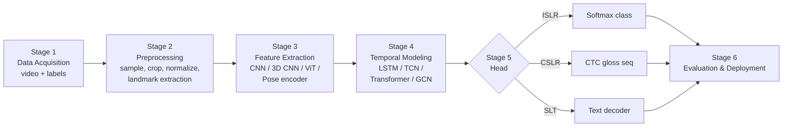
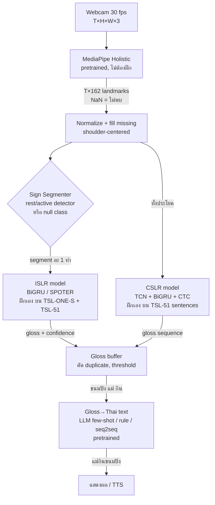
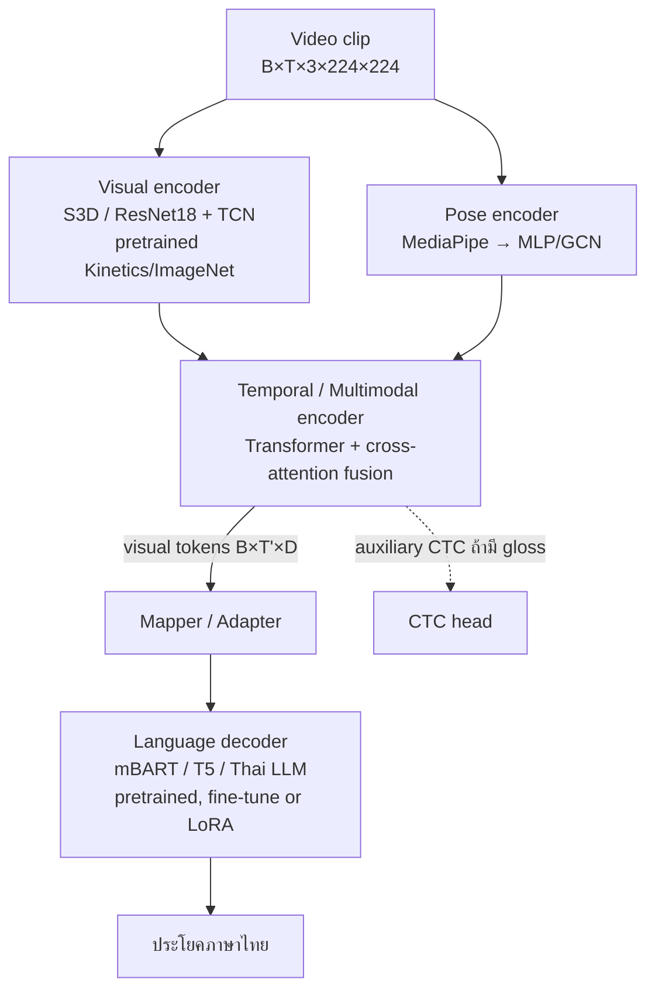

# Research Report: Deep Learning for Sign Language Recognition & Translation

> จัดทำตาม `ResearchPrompt.md` · วันที่ 7 พ.ย. 2026 · โปรเจกต์ Sign2Say
>
> **วิธีอ่านป้ายกำกับในรายงานนี้**
> - ✅ **ตรวจแล้ว** = ตัวเลข/ข้อเท็จจริงตรวจจากตารางในบทความต้นฉบับ (arXiv/CVF) หรือจากไฟล์ในเครื่องของเราโดยตรงในรอบนี้
> - 🟡 **แหล่งรอง** = เห็นจาก abstract หรือ leaderboard/สรุปของบุคคลที่สาม ยังไม่ได้เปิดตารางต้นฉบับ → ต้องตรวจก่อนนำไปอ้างในรายงานจริง
> - 💭 **ความเห็นผู้วิเคราะห์** = ข้อเสนอแนะ/การตีความของผู้เขียนรายงาน ไม่ใช่ข้อเท็จจริงจากงานวิจัย
> - ❓ **ไม่พบข้อมูล** = ค้นแล้วยืนยันไม่ได้

---

## 1. Executive Summary

1. **งานวิจัยแบ่งเป็น 3 ระดับปัญหาที่ยากขึ้นตามลำดับ**: ISLR (รู้จำทีละคำ → classification), CSLR (รู้จำลำดับคำโดยไม่รู้ขอบเขต → sequence labeling ด้วย CTC), SLT (แปลเป็นประโยคภาษาพูด → sequence-to-sequence) แต่ละระดับใช้ head, loss และ metric ต่างกัน (Accuracy → WER → BLEU/ROUGE/chrF)
2. **Input หลักมี 2 สาย**: RGB (I3D, S3D, ResNet, VideoMAE) กับ Landmark/Pose (MediaPipe, HRNet → GCN/Transformer/GRU) งานที่ได้ผลดีที่สุดบน benchmark หลายตัวใช้ **ทั้งสองสายร่วมกัน** (SAM-SLR, NLA-SLR, TwoStream) แต่ landmark-only ถูกกว่ามากและทนต่อฉากหลัง/แสงได้ดีกว่า
3. **SLT มีสองค่ายหลัก**: gloss-based (Sign→Gloss→Text หรือ multi-task CTC+CE) ซึ่งยังให้ BLEU สูงสุดบน PHOENIX14T (TwoStream-SLT 28.95 ✅) กับ gloss-free (GFSLT-VLP 21.44 ✅, Sign2GPT, Uni-Sign) ที่ไม่ต้องใช้ gloss annotation และขยายขนาดข้อมูลได้ง่ายกว่า ช่องว่างระหว่างสองค่ายกำลังแคบลง แต่ยังสรุปไม่ได้ว่าค่ายไหนดีกว่าในทุกกรณี
4. **ข้อมูลคือคอขวด** ภาษามือส่วนใหญ่ (รวมถึงไทย) มีข้อมูลน้อย, license มักเป็น non-commercial, และหลายชุดมีผู้แสดงน้อย → ผลบน test set ที่ไม่ signer-independent มักสูงเกินจริง
5. **ภาษามือไทย (TSL)**: มีชุดข้อมูลระดับคำที่ใช้ได้จริงแล้ว (TSL-ONE-S 184 คำ/29 คน, TSL-51 51 คำ + 76 ประโยค, One-Stage-TFS ตัวสะกดนิ้ว 15 ตัว) แต่ **ยังไม่มีชุดข้อมูล SLT ภาษาไทยขนาดใหญ่ที่เปิดสาธารณะ** ที่ค้นพบ
6. ⚠️ **ข้อค้นพบสำคัญจากไฟล์ในเครื่อง**: ไฟล์ split `tsl_one_s_dataset_i3d.json` ที่เรามี **ไม่ใช่ signer-independent** — ผู้แสดงทั้ง 29 คนปรากฏทั้งใน train, val และ test (ดู §7.3) ขัดกับที่บทความ TSL-ONE-S ระบุ ต้องสร้าง split ใหม่เองก่อนรายงานผล
7. 💭 **แนะนำเส้นทางสำหรับ Sign2Say**: เริ่มจาก ISLR แบบ landmark บน TSL-ONE-S (signer-independent) → ต่อด้วย CSLR ด้วย CTC บนประโยคของ TSL-51 → ปิดด้วย gloss→ภาษาไทยด้วย LLM แล้วค่อยทดลอง RGB+Landmark fusion เป็นส่วนวิจัย

---

## 2. พื้นฐาน: SLR vs CSLR vs SLT

### 2.1 คำศัพท์ที่ต้องรู้ก่อน

| คำ | ความหมาย |
|---|---|
| **Sign / Gloss** | **Gloss** คือ "ป้ายชื่อ" ที่เขียนแทนท่ามือหนึ่งท่าด้วยคำในภาษาพูด เช่น `ฉัน`, `ข้าว`, `กิน` — ไม่ใช่การแปล แต่เป็นการถอดท่าตามลำดับที่ทำจริง |
| **Gloss sequence** | ลำดับ gloss ของประโยค เช่น TSL-51: ประโยคไทย "ฉันกินข้าว" → gloss `ฉัน ข้าว กิน` (ลำดับตามไวยากรณ์ภาษามือ ✅ จาก README) |
| **Fingerspelling** | การสะกดตัวอักษรด้วยมือ (ก ข ค…) มักใช้กับชื่อเฉพาะ |
| **Signer-independent** | ผู้แสดงใน test ไม่เคยปรากฏใน train — วัดความสามารถใช้กับ "คนใหม่" ได้จริง |
| **Manual / Non-manual features** | Manual = มือ (รูปมือ, ตำแหน่ง, การเคลื่อนที่, ทิศ); Non-manual = สีหน้า, คิ้ว, ปาก, ท่าลำตัว ซึ่งมีหน้าที่ทางไวยากรณ์ (เช่น คำถาม/ปฏิเสธ) |
| **CTC** (Connectionist Temporal Classification) | loss ที่ให้ฝึก sequence labeling โดยไม่ต้องรู้ว่าแต่ละคำเริ่ม/จบที่เฟรมไหน (Graves et al., ICML 2006) |
| **WER** (Word Error Rate) | (Substitution + Deletion + Insertion) / จำนวนคำอ้างอิง — ยิ่งต่ำยิ่งดี |
| **BLEU-4** | ความเหมือนของ n-gram (1–4) ระหว่างคำแปลกับคำอ้างอิง — ยิ่งสูงยิ่งดี |

### 2.2 เปรียบเทียบ 3 งาน

| | ISLR (Isolated) | CSLR (Continuous) | SLT (Translation) |
|---|---|---|---|
| Input | คลิปสั้น 1 ท่า (~1–3 วินาที) | วิดีโอประโยค | วิดีโอประโยค |
| Output | 1 class label | ลำดับ gloss (ตามลำดับท่า) | ประโยคภาษาพูด (ไวยากรณ์ภาษาพูด) |
| ประเภทปัญหา | Classification | Sequence labeling (monotonic alignment) | Sequence-to-sequence (non-monotonic, มีการเรียงคำใหม่) |
| Loss หลัก | Cross-Entropy | CTC | Cross-Entropy แบบ autoregressive (+CTC ถ้ามี gloss) |
| Metric | Top-1/Top-5 Accuracy | WER | BLEU, ROUGE-L, chrF, (BLEURT) |
| Annotation ที่ต้องมี | label ต่อคลิป | gloss ต่อประโยค (ไม่ต้องระบุเวลา) | ข้อความแปล (± gloss) |
| ตัวอย่าง dataset | WLASL, AUTSL, MS-ASL, TSL-ONE-S | PHOENIX-2014, CSL-Daily | PHOENIX-2014T, CSL-Daily, How2Sign, BOBSL |

> 💡 **ทำไม SLT ยากกว่า CSLR?** CSLR แค่ "ถอดท่าตามลำดับ" แต่ SLT ต้อง "เปลี่ยนไวยากรณ์" ด้วย เช่น gloss `ขนมปัง แม่ กิน` → ไทย "แม่กินขนมปัง" ต้องสลับลำดับและอาจเติมคำที่ภาษามือไม่ได้แสดงออกมาตรง ๆ

---

## 3. Taxonomy ของแนวทางและ Architecture

```mermaid
mindmap
  root((Sign Language Understanding))
    Input Modality
      RGB frames
      Optical flow
      Depth / Kinect
      2D/3D Landmarks
        MediaPipe Holistic
        HRNet / OpenPose
      Sensor / Glove
    Feature Extractor
      2D CNN per frame
        ResNet, MobileNet, DenseNet
      3D CNN
        I3D, S3D, R(2+1)D
      Video Transformer
        VideoMAE, TimeSformer
      Pose Encoder
        MLP, GCN, ST-GCN, SL-GCN
    Temporal Model
      LSTM / GRU / BiLSTM
      1D Temporal Conv
      Transformer Encoder
      Spatio-temporal GCN
    Head / Task
      Classification ISLR
      CTC CSLR
      Seq2Seq decoder SLT
      Multi-task CTC + CE
      LLM decoder
```

**แยกบทบาทให้ชัด** (จุดที่คนสับสนบ่อย):

| ชื่อ | บทบาท | หมายเหตุ |
|---|---|---|
| ResNet / MobileNet / DenseNet | **Backbone / Spatial feature extractor** (ต่อเฟรม) | ไม่มีมิติเวลาในตัว ต้องต่อ temporal model |
| I3D / S3D | **Spatiotemporal feature extractor** (หรือทั้งระบบสำหรับ ISLR) | เรียนเวลาระยะสั้นในตัว (ช่วงประมาณ 16–64 เฟรม) |
| VideoMAE / TimeSformer | **Video backbone** แบบ Transformer | ต้องการ pretrain หนัก |
| MediaPipe Holistic / HRNet | **Pose estimator (preprocessing)** — ไม่ได้ฝึกเอง | output = พิกัด keypoint |
| ST-GCN / SL-GCN | **Spatio-temporal encoder** บน skeleton graph | |
| SPOTER | **ทั้งระบบ ISLR** (pose → Transformer → class) | |
| LSTM/GRU/Transformer Encoder | **Temporal encoder** | |
| CTC head | **Recognition head** สำหรับ CSLR | |
| mBART / T5 / GPT | **Language decoder** (หรือ encoder-decoder) สำหรับ SLT | ใช้ pretrained ได้ |
| VAC, CorrNet, TwoStream-SLR | **ทั้งระบบ CSLR** | |
| SLRT (Sign Language Transformers), MMTLB, TwoStream-SLT, GFSLT-VLP, Sign2GPT, Uni-Sign | **ทั้งระบบ SLT** | |

---

## 4. ตารางสรุปงานวิจัยที่ตรวจสอบได้

### 4.1 Survey / Position papers (อ่านก่อนเพื่อภาพรวม)

| งาน | แหล่ง | ใช้ทำอะไร |
|---|---|---|
| Koller, *Quantitative Survey of the State of the Art in Sign Language Recognition* (2020) | arXiv [2008.09918](https://arxiv.org/abs/2008.09918) | สำรวจเชิงปริมาณ dataset/ผลลัพธ์ ISLR/CSLR ช่วงก่อน 2020 |
| De Coster, Shterionov, Van Herreweghe, Dambre, *Machine Translation from Signed to Spoken Languages: State of the Art and Challenges* (2022/2023) | arXiv [2202.03086](https://arxiv.org/abs/2202.03086) | survey SLT ครบที่สุดเรื่อง pipeline, dataset, metric |
| Müller, Jiang, Moryossef, Rios, Ebling, *Considerations for meaningful sign language machine translation based on glosses* — ACL 2023 (Outstanding Paper) | [ACL Anthology 2023.acl-short.60](https://aclanthology.org/2023.acl-short.60), DOI 10.18653/v1/2023.acl-short.60 | ✅ วิจารณ์การใช้ gloss: ทบทวน 14 งาน พบว่าข้อจำกัดของ gloss/dataset ไม่ถูกรายงานอย่างโปร่งใสและไม่มีมาตรฐานการประเมิน |

### 4.2 Original research — ตัวแทนแต่ละแนวทาง

> ⚠️ ตัวเลขในตารางนี้ **ห้ามเทียบข้ามแถวที่ dataset ต่างกัน** และแม้ dataset เดียวกันก็ต้องดูว่าใช้ split/modality เดียวกันหรือไม่

#### (A) ISLR

| งาน | Dataset | Architecture & Pipeline | Loss / Training | ผล | Code | ข้อสังเกต |
|---|---|---|---|---|---|---|
| **WLASL** — Li, Rodriguez, Yu, Li, WACV 2020, DOI 10.1109/WACV45572.2020.9093512, [arXiv 1910.11006](https://arxiv.org/abs/1910.11006) | WLASL: >2,000 คำ ASL, >100 ผู้แสดง, จาก web | (1) RGB: I3D (pretrained Kinetics) (2) Pose: Pose-TGCN บน keypoint 2D | CE | I3D top-1 WLASL2000 = 32.48, WLASL100 = 65.89 🟡 (leaderboard); Pose ≈ RGB ที่ top-10 ~66% บน 2000 คำ ✅ (abstract) | [dxli94/WLASL](https://github.com/dxli94/WLASL) | วิดีโอจาก web หลายลิงก์หายไปแล้ว → ต้องขอ/ตรวจว่าโหลดได้ครบเท่าไร |
| **SPOTER** — Boháček & Hrúz, WACV Workshops 2022, pp.182–191 ([CVF](https://openaccess.thecvf.com/content/WACV2022W/HADCV/html/Bohacek_Sign_Pose-Based_Transformer_for_Word-Level_Sign_Language_Recognition_WACVW_2022_paper.html)) | WLASL100/300, LSA64 | Pose (body+hands) → normalize → Transformer encoder → decoder ที่มี **class query เดียว** → linear | CE; augmentation: rotation, squeeze, perspective, sequential joint rotation | WLASL100 63.18%, WLASL300 43.78%, LSA64 100% ✅ (abstract) | [maty-bohacek/spoter](https://github.com/maty-bohacek/spoter) | เบา (~5.9M params ตาม TSL-ONE-S paper) เหมาะเป็น baseline ภาษาไทย |
| **SAM-SLR** — Jiang et al., CVPRW 2021, DOI 10.1109/CVPRW53098.2021.00380, [arXiv 2103.08833](https://arxiv.org/abs/2103.08833) | AUTSL (signer-independent challenge) | Whole-body skeleton → **SL-GCN** + Separable ST-Conv, รวมกับ RGB/flow/depth streams → late fusion (ensemble) | CE ต่อ stream แล้วรวม score | RGB 98.42%, RGB-D 98.53% ✅ (abstract) | [jackyjsy/CVPR21Chal-SLR](https://github.com/jackyjsy/CVPR21Chal-SLR) | เป็น ensemble หลาย modality → แพงเกินสำหรับ real-time |
| **NLA-SLR** — Zuo, Wei, Mak, CVPR 2023, pp.14890–14900, [arXiv 2303.12080](https://arxiv.org/abs/2303.12080) | WLASL, MS-ASL, NMFs-CSL | Video-Keypoint Network (RGB + keypoint สอง stream) + ใช้ความหมายของ gloss (fastText) ช่วย: language-aware label smoothing, inter-modality mixup | CE + label smoothing ที่ถ่วงด้วย semantic similarity | WLASL2000 top-1 per-instance 61.05% (1-crop) / 61.26% (3-crop) ✅ | [FangyunWei/SLRT](https://github.com/FangyunWei/SLRT) | ตัวอย่างการใช้ "ภาษา" ช่วย vision ใน ISLR |
| **TSL-ONE-S** — Chalotonpised, Vijitkunsawat, Chen, Lin, IEEE Access vol.14, 2026, DOI [10.1109/ACCESS.2026.3670970](https://doi.org/10.1109/ACCESS.2026.3670970) | TSL-ONE-S (ไทย) 4,152 คลิป, 184 gloss, 29 คน | I3D (InceptionV1, Kinetics) vs SPOTER (MediaPipe pose) | Adam lr 1e-4, batch 16, 80 epochs, early stopping | I3D 79.69%, SPOTER 80.83% top-1 ✅ (จาก PDF ในเครื่อง) | ไม่พบ code repo บน [tsl-one.github.io](https://tsl-one.github.io/) | ⚠️ ดู §7.3: ไฟล์ split ที่เรามีไม่ signer-independent |

#### (B) CSLR

| งาน | Dataset | Architecture & Pipeline | Loss | ผล (WER dev/test) | Code | ข้อสังเกต |
|---|---|---|---|---|---|---|
| **CTC** — Graves et al., ICML 2006 | (speech) | พื้นฐานของ CSLR เกือบทั้งหมด | CTC | – | – | อ่านเพื่อเข้าใจ blank token และ alignment |
| **VAC** — Min, Hao, Chai, Chen, ICCV 2021, pp.11542–11551, [arXiv 2104.02330](https://arxiv.org/abs/2104.02330) | PHOENIX-2014, CSL | ResNet18 (ต่อเฟรม) → 1D-Conv → BiLSTM → CTC | CTC + **Visual Enhancement loss** (CTC บน feature ก่อน BiLSTM) + **Visual Alignment loss** (distill จาก BiLSTM ไป visual) | ❓ ไม่ได้เปิดตาราง | [VIPL-SLP/VAC_CSLR](https://github.com/VIPL-SLP/VAC_CSLR) (Apache-2.0) | ชี้ว่าปัญหาหลักของ CSLR คือ feature extractor ถูกฝึกไม่พอ (CTC ให้ gradient ที่อ่อน) |
| **CorrNet** — Hu, Gao, Liu, Feng, CVPR 2023, pp.2529–2539 ([CVF](https://openaccess.thecvf.com/content/CVPR2023/html/Hu_Continuous_Sign_Language_Recognition_With_Correlation_Network_CVPR_2023_paper.html)) | PHOENIX-2014/2014T, CSL-Daily | ResNet18 + **identification module** (เน้นบริเวณมือ/หน้า) + **correlation module** (เทียบเฟรมกับเฟรมข้างเคียงเพื่อจับ trajectory) → 1D-Conv → BiLSTM → CTC | CTC (+VAC-style aux) | PHOENIX-2014 18.8 / 19.4 🟡 | [hulianyuyy/CorrNet](https://github.com/hulianyuyy/CorrNet) | ตัวเลือกดีสำหรับ RGB CSLR ที่ GPU เดียวพอฝึก |
| **TwoStream-SLR** — Chen, Zuo, Wei, Wu, Liu, Mak, NeurIPS 2022, [arXiv 2211.01367](https://arxiv.org/abs/2211.01367) | PHOENIX-2014/2014T, CSL-Daily | S3D (RGB) + S3D (keypoint heatmap จาก HRNet, 79 จุด) + lateral connections สองทาง + sign pyramid network | CTC ต่อ head + aux CTC + self-distillation (KL) | PHOENIX-2014 18.4/18.8; 2014T 17.7/19.3; CSL-Daily 25.4/25.3 ✅ | [FangyunWei/SLRT](https://github.com/FangyunWei/SLRT) | Hybrid RGB+pose แบบ fusion ระหว่างชั้น |
| **Lata (Siriwiwat), PhD thesis, Mahasarakham Univ. 2023** (ไฟล์ในเครื่อง) | TSLS (ประโยคภาษามือไทย) | CNN (DenseNet121/ResNet50/VGG16) → Conv1D 1–4 ชั้น → BiLSTM/BiGRU → CTC | CTC | best WER = 0.4286 (DenseNet121 + 4×Conv1D + BiLSTM 128) ✅ | ❓ | งาน CSLR ไทยที่มีหลักฐานชัด แต่ข้อมูลเล็ก |

#### (C) SLT

| งาน | Dataset | Pipeline | Loss / Training | ผล BLEU-4 (test) | Code | ข้อสังเกต |
|---|---|---|---|---|---|---|
| **Neural SLT** — Camgöz, Hadfield, Koller, Ney, Bowden, CVPR 2018 | **เปิดตัว PHOENIX-2014T** | CNN → RNN encoder-decoder + attention; เทียบ Sign2Text, Sign2Gloss2Text | CE | Sign2Text 9.58 ✅ (อ้างใน abstract ของงาน 2020) | – | จุดเริ่มต้นของ SLT แบบ neural |
| **Sign Language Transformers (SLRT)** — Camgöz, Koller, Hadfield, Bowden, CVPR 2020, [arXiv 2003.13830](https://arxiv.org/abs/2003.13830) | PHOENIX-2014T | CNN (Inception จาก CNN-LSTM-HMM ที่ฝึกบน sign data) → Transformer encoder → (CTC head สำหรับ gloss) + Transformer decoder (ข้อความ) | λR·CTC + λT·CE (λR=5, λT=1) | Sign2(Gloss+Text) **21.80** (WER 24.49); Sign2Gloss2Text 22.45; Sign2Text 20.17; Gloss2Text 24.54 ✅ | [neccam/slt](https://github.com/neccam/slt) | ✅ ผู้เขียนรายงานว่า feature ที่ pretrained บน ImageNet (EfficientNet) **แย่กว่า** feature ที่ pretrained บน sign data |
| **MMTLB** — Chen et al., CVPR 2022, [arXiv 2203.04287](https://arxiv.org/abs/2203.04287) | PHOENIX-2014T, CSL-Daily | S3D (pretrain Kinetics → sign recognition) → visual-language mapper → **mBART** | progressive pretraining: visual (CTC) + language (gloss2text) แล้ว joint | 28.39 (P14T), 23.92 (CSL-Daily) ✅ (จากตารางของ GFSLT) | [FangyunWei/SLRT](https://github.com/FangyunWei/SLRT) | หลักฐานว่า pretrained LM ช่วย SLT มาก |
| **TwoStream-SLT** — NeurIPS 2022 (ข้างบน) | PHOENIX-2014T, CSL-Daily | TwoStream-SLR + MLP + mBART-large-cc25 ต่อแต่ละ head แล้ว ensemble | CTC + CE; freeze S3D ตอนฝึก SLT | Sign2Text **28.95** (P14T), 25.79 (CSL-Daily); Sign2Gloss2Text 26.71 / 24.13 ✅ | [FangyunWei/SLRT](https://github.com/FangyunWei/SLRT) | ✅ end-to-end ดีกว่า cascade ในงานนี้ |
| **GFSLT-VLP** — Zhou et al., ICCV 2023, pp.20871–20881, [arXiv 2307.14768](https://arxiv.org/abs/2307.14768) | PHOENIX-2014T, CSL-Daily | **gloss-free**: ResNet18 → Conv1D → Transformer; Stage 1 = CLIP-style contrastive + masked text reconstruction; Stage 2 = encoder-decoder | Stage1: L_contrastive + 0.1·L_mask; Stage2: label-smoothed CE | 21.44 / ROUGE 42.49 (P14T); 11.00 (CSL-Daily); ไม่มี VLP = 19.66 ✅ | [zhoubenjia/GFSLT-VLP](https://github.com/zhoubenjia/GFSLT-VLP) | ✅ ยังต่ำกว่า gloss-based ที่ดีที่สุด (28.95) ชัดเจน |
| **Sign2GPT** — Wong, Camgöz, Bowden, ICLR 2024, [arXiv 2405.04164](https://arxiv.org/abs/2405.04164) | PHOENIX-2014T, CSL-Daily | pretrained vision encoder + adapters → **frozen GPT LM**; pretrain ด้วย pseudo-gloss ที่ดึงจากประโยคอัตโนมัติ (ไม่ต้องรู้ลำดับ) | – | 22.52 (P14T), 15.4 (CSL-Daily) 🟡 | ❓ | แนวทาง "ใช้ LLM เป็น decoder" |
| **YouTube-ASL** — Uthus, Tanzer, Georg, NeurIPS 2023 D&B, [arXiv 2306.15162](https://arxiv.org/abs/2306.15162) | YouTube-ASL ~984 ชม., >2,500 ผู้แสดง → ทดสอบ How2Sign | MediaPipe Holistic landmarks → embed เข้า **T5** | CE | How2Sign: 12.39 (fine-tuned) vs SOTA เดิม 8.03; zero-shot 3.95 ✅ (abstract) | – | landmark + LM ใหญ่ + ข้อมูลเยอะ ใช้ได้กับ open-domain |
| **Uni-Sign** — Li et al., ICLR 2025, [arXiv 2501.15187](https://arxiv.org/abs/2501.15187) | CSL-News 1,985 ชม. (ใหม่) + benchmark หลายชุด | pretrain แบบ generative ขนาดใหญ่ แล้วแปลงทุก downstream task (ISLR/CSLR/SLT) เป็นรูป "translation"; prior-guided fusion ของ pose + RGB | – | ผู้เขียนอ้าง SOTA หลาย benchmark 🟡 | [ZechengLi19/Uni-Sign](https://github.com/ZechengLi19/Uni-Sign) | แนวโน้มปี 2025: foundation model สำหรับภาษามือ |

#### (D) งานภาษามือไทยในเครื่อง

| งาน | Dataset | Pipeline | ผล | ข้อสังเกต (💭) |
|---|---|---|---|---|
| **Lata & Surinta, ICIC Express Letters 2022** DOI 10.24507/icicel.16.05.529 (บท 2 ของ thesis) | TFS (ภาพนิ่ง ตัวสะกด 1-stage 15 ตัว) + KKU-TFS + Unseen-TFS | YOLOv3 (crop มือ) → CNN (MobileNetV2/DenseNet121/…) transfer learning | YOLOv3 mAP 0.9787 บน TFS แต่ 0.6553 บน KKU-TFS, 0.7944 บน Unseen-TFS; DenseNet121 end-to-end 93.99% / 90.40% / 82.00% ✅ | ประสิทธิภาพตกชัดเมื่อเปลี่ยนชุดข้อมูล → หลักฐานเรื่อง domain shift |
| **Thammasit & Sompong, วารสาร IT มจพ. ปีที่ 22 ฉ.1 (2026)** DOI 10.14416/j.it.2026.v1.005 | TSL10: 10 คำ, 1,000 คลิป (train 900 จากล่ามและผู้บกพร่องฯ; test 100 จากผู้บกพร่องฯ 5 คนที่ไม่อยู่ใน train) | MediaPipe Holistic 1,662 ค่า/เฟรม × ~30 เฟรม → LSTM / GRU / BiLSTM | TSL10-Test: LSTM 99%, GRU 99%, BiLSTM 98% ✅ | 💭 น่าสังเกต: 5-fold CV บน train ได้แค่ราว 80% (ตาราง 80:20 ≈ 79.62%) แต่ unseen test ได้ 99% — ผล test สูงกว่า CV ผิดปกติ ควรตีความอย่างระวัง; มีแค่ 10 คำ |

---

## 5. Pipeline ของแต่ละแนวทาง (Stage 1–6)

### 5.1 ภาพรวม pipeline ร่วม



### Stage 1: Data Acquisition

| ประเด็น | สิ่งที่ต้องบันทึก/ตรวจ | ตัวอย่างจริง |
|---|---|---|
| แหล่งวิดีโอ | สตูดิโอ / ทีวี / web / มือถือ | PHOENIX = รายการพยากรณ์อากาศทีวี; How2Sign = สตูดิโอ multi-view; WLASL = web; TSL-ONE-S = 9 โรงเรียนทั่วไทย ในสภาพจริง ✅ |
| กล้อง/ความละเอียด/FPS | กระทบ motion blur ของนิ้ว | TSL-ONE-S: ขาตั้งกล้องระดับอก 1–2 ม., 1280×720, 29.97 fps ✅; TSL-51 user: 640×480, 30 fps ✅ |
| จำนวนผู้แสดง | ตัวแปรสำคัญที่สุดต่อ generalization | PHOENIX14T 9 คน; TSL-ONE-S 29 คน; TSL-51 ประโยค = 1 คน ✅ |
| Split | **ต้องแยกตามผู้แสดง** | BOBSL แยก signer ไม่ซ้ำข้าม split ✅ |
| Label format | class / gloss seq / text / timestamps | TSL-ONE-S: JSON `{gloss, instances:[{video_id, split}]}` ✅ |

### Stage 2: Preprocessing

1. **Frame sampling** — ISLR: สุ่ม/เฉลี่ย T เฟรมคงที่ (เช่น 16, 32, 64); CSLR/SLT: ใช้ทุกเฟรมหรือ stride 1–2 เพราะลำดับต้องครบ
2. **Temporal trimming** — TSL-ONE-S ตัดคลิปอัตโนมัติด้วยกฎ "มือวางบนตัก = พัก" โดยใช้ MediaPipe: เริ่มท่าเมื่อมีเฟรม active ติดกัน ≥ T_A, จบเมื่อ rest ≥ T_R แล้วตรวจด้วยมืออีกครั้ง ✅
3. **Spatial crop** — crop ตาม bounding box ของ pose/มือ (TSL-ONE-S ใช้ landmark ทั้งหมด + margin) หรือ crop มือด้วย detector (YOLO ในงาน TFS)
4. **Resize & normalize** — I3D: ด้านสั้น 256 → random crop 224 + flip 0.5, ค่าพิกเซลอยู่ใน [−1, 1] ✅ (TSL-ONE-S)
   - ⚠️ **ระวัง horizontal flip**: สลับมือถนัดซ้าย/ขวา ซึ่งในภาษามือส่วนใหญ่ยังหมายถึงคำเดิม แต่ถ้ามีท่าที่ทิศทางมีความหมาย (ชี้ซ้าย/ขวา) อาจเปลี่ยนความหมาย 💭
5. **Landmark extraction** — MediaPipe Holistic: pose 33 จุด (x,y,z,visibility), face 468, มือ 21×2 → **1,662 ค่า/เฟรม** (= 33×4 + 468×3 + 42×3) ตรงกับงาน TSL10 ✅; TSL-51 เลือกเฉพาะ 54 จุด → 162 ค่า ✅
6. **Landmark normalization** — ทำให้ไม่ขึ้นกับตำแหน่ง/ขนาดตัว: ลบด้วยจุดกลางไหล่ แล้วหารด้วยความกว้างไหล่; มือ normalize ใน bounding box ของมือเอง (แนวทาง SPOTER ✅)
7. **Missing landmarks** — MediaPipe ตรวจมือไม่เจอบ่อยเมื่อมือเบลอ/ซ้อนกัน → TSL-51 เก็บเป็น `NaN` ✅; ทางเลือก: เติม 0 + mask, interpolate, หรือใช้ค่าล่าสุด
8. **Augmentation** — RGB: crop, color jitter, blur, speed; Landmark: rotation, scale, shear, perspective, joint rotation, frame drop, time-warp
9. **ความยาวไม่เท่ากัน** — ISLR: resample ให้เป็น T คงที่ หรือ pad + attention mask; CSLR/SLT: pad ใน batch + ส่ง `lengths` ให้ CTC / mask ใน Transformer

### Stage 3: Feature Extraction — Tensor shapes

**ตัวอย่างที่ 1: ISLR ด้วย I3D**
```
video        [T, H, W, C]      = [64, 720, 1280, 3]     (อ่านด้วย OpenCV → BGR → RGB)
resize+crop  [T, 224, 224, 3]
batch+permute[B, C, T, H, W]   = [16, 3, 64, 224, 224]  (Conv3d ต้องการ channel-first)
I3D conv     [B, 1024, T/8, 7, 7] = [16, 1024, 8, 7, 7]
global pool  [B, 1024]
classifier   [B, num_classes]  = [16, 184]
```

**ตัวอย่างที่ 2: CSLR ด้วย 2D CNN + BiLSTM (แบบ VAC/CorrNet)**
```
video        [B, T, 3, 224, 224]          T = 200 เฟรม
reshape      [B*T, 3, 224, 224]           → ResNet18 (ImageNet)
frame feat   [B*T, 512] → [B, T, 512]
1D conv ×2 (K5,P2,K5,P2)  [B, T/4, 1024]  = [B, 50, 1024]  (ลดความยาว ×4)
BiLSTM       [B, 50, 2×512]
CTC logits   [B, 50, V+1]                 (+1 = blank)
→ log_softmax → transpose เป็น [50, B, V+1] สำหรับ nn.CTCLoss
```

**ตัวอย่างที่ 3: Landmark (TSL-51 / TSL-ONE-S)**
```
CSV ต่อคลิป  [T, 162]  (54 จุด × xyz)
normalize    [T, 54, 3]
ISLR (GRU/SPOTER)     → [B, T, 162] → class
ST-GCN               → [B, C=3, T, V=54, M=1]  (รูปแบบ ST-GCN: channel, time, vertex, person)
```

> 💡 ความต่างของ cost: วิดีโอ 64 เฟรมที่ 224×224×3 ≈ 9.6M ค่า; landmark 64×162 ≈ 10K ค่า — **ต่างกันราว 1,000 เท่า** (คิดจาก shape โดยตรง) จึงเป็นเหตุที่ SPOTER ฝึกบน TSL-ONE-S 1:48 ชม. vs I3D 21:41 ชม. ✅ (แม้ใช้ GPU คนละรุ่น — ต้องระวังการเทียบ)

### Stage 4: Temporal Modeling — แต่ละวิธีเรียนการเคลื่อนไหวอย่างไร

| วิธี | กลไก | ข้อดี | ข้อจำกัด |
|---|---|---|---|
| **LSTM/GRU** | hidden state ส่งต่อทีละเฟรม; gate ตัดสินว่าจำ/ลืมอะไร | เบา, ทำ online ได้ (unidirectional) | ประมวลผลขนานไม่ได้, ความจำระยะยาวจำกัด |
| **BiLSTM** | อ่านไป-กลับ แล้ว concat | ใช้บริบทอนาคต → แม่นขึ้นใน CSLR | ต้องรอจบประโยค → ไม่ real-time แท้ |
| **1D Temporal Conv (TCN)** | kernel เลื่อนบนแกนเวลา จับ pattern ระยะสั้น (เช่น 5 เฟรม) | ขนานได้, ใช้ลด frame rate ก่อน LSTM | receptive field จำกัดตามความลึก |
| **3D Conv** | kernel ครอบ (t,h,w) จับ motion ระยะสั้นพร้อม appearance | เรียน motion จาก pixel โดยตรง | แพง, ต้อง pretrain (Kinetics) |
| **Transformer Encoder** | self-attention: ทุกเฟรมดูทุกเฟรม, ต้องเติม positional encoding | จับความสัมพันธ์ระยะไกล, ขนานได้ | O(T²) memory, ข้อมูลน้อย → overfit ง่าย |
| **ST-GCN / SL-GCN** | spatial graph conv บนกราฟข้อต่อ (นิ้ว-ข้อมือ-ศอก) + temporal conv บนจุดเดียวกันข้ามเฟรม | ใช้โครงสร้างร่างกายเป็น prior, เบา | ขึ้นกับคุณภาพ pose estimator |
| **Temporal attention pooling** | ให้น้ำหนักเฟรมสำคัญก่อน pool | ลดผลจากเฟรมพัก | ใช้ได้กับ ISLR เป็นหลัก |

### Stage 5: Heads, Loss, Decoding

| Head | Output | Loss | Decoding / Post-processing |
|---|---|---|---|
| Classification (ISLR) | `[B, C]` logits | Cross-Entropy (± label smoothing) | argmax / top-k; ใส่ threshold + คลาส `null` สำหรับระบบจริง (TSL-51 มี `null_act` ✅) |
| CTC (CSLR) | `[T', B, V+1]` | CTC: รวมความน่าจะเป็นของทุก alignment ที่ยุบแล้วได้ลำดับ gloss ถูก | greedy (ยุบตัวซ้ำ → ลบ blank) หรือ beam search (± LM) |
| Gloss decoder | gloss tokens | CE | beam search |
| Text decoder (seq2seq) | token ของภาษาพูด | CE แบบ teacher forcing (± label smoothing) | beam search, length penalty; ภาษาไทยต้องระวัง tokenization (ไม่มีช่องว่างระหว่างคำ) |
| Multi-task | gloss + text | λR·CTC + λT·CE | ใช้ text เป็นผลลัพธ์ หรือเลือกได้ |
| LLM decoder | ข้อความ | CE ผ่าน adapter/prefix (LM frozen) | prompt/generation config |

**CTC ทำงานอย่างไร (ตัวอย่าง)**: เฟรม output `- ฉัน ฉัน - - ข้าว ข้าว - กิน -` → ยุบตัวซ้ำ → `- ฉัน - ข้าว - กิน -` → ลบ blank `-` → `ฉัน ข้าว กิน` ✔️ ข้อกำหนด: ความยาว output T' ต้อง ≥ ความยาว gloss (+ จำนวนตัวซ้ำติดกัน) และ alignment ต้อง **monotonic** — จึงใช้ได้กับ CSLR แต่ใช้แปลเป็นภาษาพูด (ที่ต้องเรียงคำใหม่) โดยตรงไม่ได้

### Stage 6: Evaluation & Deployment

| Metric | ใช้กับ | ข้อจำกัด |
|---|---|---|
| Top-1/Top-5 Accuracy | ISLR | ถ้าคลาสไม่สมดุลควรรายงาน **per-class accuracy** / macro-F1 ด้วย (NLA-SLR รายงานทั้ง per-instance และ per-class ✅) |
| WER | CSLR | ไม่สนความหมาย: gloss ผิด 1 ตัวที่เป็นคำปฏิเสธ = ผิดเท่ากับคำทั่วไป |
| BLEU-4 | SLT | ประโยคเดียวกันพูดได้หลายแบบ แต่ BLEU ให้คะแนนตามการซ้อนทับของคำเท่านั้น; ภาษาไทยต้อง tokenize ก่อน → **คะแนนขึ้นกับ tokenizer** ต้องระบุเสมอ 💭 |
| ROUGE-L | SLT | วัด longest common subsequence — ปัญหาคล้าย BLEU |
| chrF | SLT | ระดับตัวอักษร → ไม่ต้องตัดคำ **เหมาะกับภาษาไทย** มากกว่า BLEU 💭 |
| Latency / FPS / Model size / GPU memory | Deployment | ต้องวัดทั้ง pipeline (รวม MediaPipe) ไม่ใช่แค่โมเดล |
| Robustness | Deployment | ทดสอบแยกตาม: signer ใหม่, ฉากหลัง, แสง, มุมกล้อง, มือถนัด |

**Real-time**: ISLR แบบ landmark + GRU/Transformer เล็กทำได้บน CPU/มือถือ (Google ISLR Kaggle บังคับส่งเป็น TFLite ✅); CSLR แบบ online ต้องใช้ unidirectional/causal model + sliding window และ decoder ที่ตัดผลเป็นช่วง ๆ

---

## 6. เปรียบเทียบ Architecture และ Training Strategies

### 6.1 ตารางเปรียบเทียบ

| Architecture | Input | Feature Representation | Temporal Modeling | Output | จุดเด่น | ข้อจำกัด |
|---|---|---|---|---|---|---|
| 2D CNN (ภาพนิ่ง) + YOLO crop | ภาพ RGB 1 เฟรม | CNN feature ของมือ | ไม่มี | class | ง่ายมาก; ดีกับตัวสะกดแบบนิ่ง (TFS) | ใช้กับท่าที่เคลื่อนไหวไม่ได้ |
| CNN + LSTM/GRU | RGB เฟรมเรียง | CNN ต่อเฟรม (frozen/fine-tune) | LSTM/GRU | class หรือ CTC | เข้าใจง่าย, transfer learning ได้ | CNN ไม่เห็น motion; ฝึกยาก end-to-end |
| 3D CNN (I3D/S3D) | คลิป RGB | spatiotemporal feature | 3D conv (ระยะสั้น) + pooling | class / feature | มี pretrained Kinetics; baseline มาตรฐาน ISLR | หนัก; ไวต่อฉากหลัง (TSL-ONE-S: overfit ชัดกว่า SPOTER ✅) |
| Video Transformer (VideoMAE ฯลฯ) | คลิป RGB → patch tubes | token embedding | self-attention | class / feature | แข็งแรงเมื่อ pretrain ดี | ต้องการ GPU/ข้อมูลมาก |
| Landmark + MLP/GRU | keypoint ต่อเฟรม | พิกัด normalize (± ความเร็ว, มุม, ระยะ) | GRU/LSTM | class | เบามาก, ทนฉากหลัง/แสง | ข้อมูลรูปมือละเอียดหายถ้า pose estimator พลาด |
| SPOTER (pose Transformer) | keypoint | linear embed | Transformer enc + class query decoder | class | เบา, ผลดีกับข้อมูลน้อย | ไม่มีสีหน้า (ในการตั้งค่าเดิม) |
| ST-GCN / SL-GCN | skeleton graph | graph node features | spatial GCN + temporal conv | class | ใช้โครงสร้างร่างกาย | ต้องออกแบบกราฟ; ขึ้นกับคุณภาพ keypoint |
| Hybrid RGB + Landmark (TwoStream, NLA-SLR, SAM-SLR) | RGB + keypoint | 2 encoders | fusion + temporal | class / CTC / text | ผลดีที่สุดบน benchmark หลายชุด | ซับซ้อน, ช้า, ต้องจูนเยอะ |
| CNN + TCN + BiLSTM + CTC (VAC, CorrNet) | RGB ทั้งประโยค | ResNet18 ต่อเฟรม | 1D conv + BiLSTM | gloss seq | มาตรฐาน CSLR, ฝึกได้บน GPU เดียว | ต้องใช้ gloss annotation |
| Encoder-Decoder Transformer (SLRT) | feature จาก CNN | Transformer encoder | self-attention | gloss (CTC) + text | joint recognition + translation | ต้องการ gloss เพื่อให้ได้ผลดี |
| Visual encoder + pretrained LM (MMTLB, TwoStream-SLT, Sign2GPT, YouTube-ASL/T5) | RGB หรือ landmark | visual tokens → mapper | encoder ของ LM | text | ใช้ความรู้ภาษาจาก LM | ต้องมีคู่ (video, text) จำนวนมาก; hallucination |

### 6.2 Training Strategies (ทำตามได้)

| หัวข้อ | แนวปฏิบัติ | หลักฐาน/เหตุผล |
|---|---|---|
| Pretrained backbone | RGB: I3D/S3D (Kinetics-400); 2D: ResNet18 (ImageNet); Pose: MediaPipe (ไม่ต้องฝึก) | ✅ SLRT พบว่า feature ที่ pretrain บน sign data ดีกว่า ImageNet → ถ้ามีโมเดลที่ฝึกบน WLASL/AUTSL แล้ว ให้ใช้เป็นจุดเริ่มต้น (แต่ต้องรายงานว่าใช้ข้อมูลภาษาอื่น) |
| Freeze / unfreeze | ข้อมูลน้อย: freeze backbone → ฝึก head → ค่อย unfreeze ชั้นบนด้วย LR ต่ำกว่า (×0.1) | ✅ TwoStream-SLT freeze S3D ระหว่างฝึก SLT เพื่อลด overfit |
| Loss | ISLR: CE + label smoothing 0.1; CSLR: CTC (± aux CTC แบบ VAC); SLT: CE (+ CTC ถ้ามี gloss) | ✅ SLRT ใช้ λR=5 ต่อ λT=1 |
| Optimizer | Adam/AdamW lr 1e-4 (Transformer ใช้ warmup + cosine) | ✅ TSL-ONE-S ใช้ Adam 1e-4, batch 16, 80 epochs |
| Early stopping | ดู val metric (accuracy / WER) ไม่ใช่ val loss อย่างเดียว | |
| Class imbalance | weighted sampler / class-weighted CE / focal loss; รายงาน macro-F1 | TSL-ONE-S มี 16–27 คลิปต่อ gloss ✅ (ค่อนข้างสมดุล) |
| Augmentation | ดู Stage 2 | ✅ TSL-51 ขยาย expert data ×31–98 ด้วย spatial/temporal/mixed |
| Regularization | dropout, weight decay, stochastic depth, mixup ระหว่าง modality (NLA-SLR) | |
| **Data leakage** | (1) แยก split ตาม **signer** (2) clip ที่ augment จากต้นฉบับเดียวกันต้องอยู่ split เดียวกัน (3) ห้าม fit normalizer/scaler บน val/test | 💭 TSL-51 มี `original_video_id` ✅ — ต้อง group ตามคอลัมน์นี้ ไม่งั้นสำเนา blur ของคลิปเดียวกันจะหลุดไปอยู่ทั้ง train และ test |
| Signer-independent eval | Leave-signer-out หรือ GroupKFold ตาม signer; รายงาน mean ± std ข้าม fold | |
| Ablation | เปลี่ยนทีละตัว: (a) modality (b) backbone (c) temporal model (d) augmentation (e) pretraining | |
| Fair baseline comparison | ใช้ split/preprocessing/augmentation/epoch budget เดียวกัน; จูน hyperparameter ทุกโมเดลด้วยงบเท่ากัน; รายงานหลาย seed | 💭 |

### 6.3 Baselines 3 ระดับ (ข้อเสนอ 💭)

| ระดับ | Baseline | ใช้ทรัพยากร | ทำไมต้องมี |
|---|---|---|---|
| 1. ง่าย/ถูก | Landmark (MediaPipe) → สถิติต่อคลิป (mean/std/min/max ต่อจุด) → **Logistic Regression / Random Forest / XGBoost** | CPU | วัดว่า "แค่ท่าทางเฉลี่ย" ได้เท่าไร ถ้า DL ไม่ชนะ baseline นี้ แสดงว่ามีปัญหา |
| 2. DL มาตรฐาน | Landmark → **BiGRU 2 ชั้น** หรือ **SPOTER**; RGB → **I3D fine-tune** | GPU 8–12 GB | เทียบกับงาน TSL-ONE-S ได้โดยตรง |
| 3. ร่วมสมัย | **RGB + Landmark late/cross-attention fusion** หรือ **ST-GCN/SL-GCN** หรือ VideoMAE fine-tune | GPU 16–24 GB | ทดสอบว่าความซับซ้อนคุ้มไหม |

**แยกว่าการปรับปรุงมาจากไหน**: ตรึงทุกอย่างแล้วเปลี่ยนทีละองค์ประกอบ (เช่น BiGRU → Transformer โดย input/augment/epoch เท่าเดิม), ทำหลาย seed แล้วดูว่าความต่างมากกว่า std หรือไม่, และใช้ paired test (เช่น McNemar บนผลต่อคลิปของ test set เดียวกัน)

---

## 7. Dataset Comparison

### 7.1 Dataset นานาชาติ

| Dataset | ภาษามือ | งาน | ขนาด | ผู้แสดง | Annotation | License / การเข้าถึง | เหมาะกับ | ข้อจำกัด |
|---|---|---|---|---|---|---|---|---|
| **WLASL** (WACV 2020) | ASL | ISLR | >2,000 คำ (subset 100/300/1000/2000) | >100 | class label, bbox, frame range | โหลดผ่านสคริปต์จาก URL ต้นทาง ([repo](https://github.com/dxli94/WLASL)); license ❓ — ตรวจใน repo | benchmark ISLR ขนาดใหญ่ | ✅ TSL-ONE-S paper รายงานว่าลิงก์บางส่วนของชุดคล้ายกัน (MS-ASL) ใช้ไม่ได้แล้ว; WLASL ก็มาจาก web เช่นกัน |
| **MS-ASL** (BMVC 2019, [arXiv 1812.01053](https://arxiv.org/abs/1812.01053)) | ASL | ISLR | 1,000 คลาส, >25,000 คลิป (บางแหล่ง 25,513) | 222 | class label | Microsoft project page; ❓ license | ISLR signer-independent | ✅ วิดีโอบางส่วนกลายเป็น private/หายไป (ตาม TSL-ONE-S paper) |
| **AUTSL** (IEEE Access 2020, DOI 10.1109/ACCESS.2020.3028072) | Turkish SL | ISLR | 226 คำ, 38,336 คลิป | 43 | RGB + depth + skeleton (Kinect v2) | [cvml.ankara.edu.tr](https://cvml.ankara.edu.tr); license ❓ | multimodal RGB-D, signer-independent | baseline ของผู้สร้าง 62.02% แต่ SAM-SLR ได้ 98% → ช่องว่างกว้าง; ฉากสตูดิโอ |
| **Google ISLR (Kaggle 2023)** / PopSign ASL | ASL | ISLR | 250 คำ, 94,481 sequences (train) | 21 (Deaf) | **MediaPipe landmarks เท่านั้น** (ไม่มีวิดีโอ) | Kaggle rules (❓ ตรวจ); PopSign v1.0 ประกาศ CC BY 4.0 🟡 | ฝึก landmark model + deploy มือถือ | ไม่มี RGB; ถ่ายจากกล้องหน้ามือถือ |
| **RWTH-PHOENIX-Weather 2014T** | DGS (เยอรมัน) | CSLR + SLT | 8,257 ประโยค (7,096 / 519 / 642); gloss vocab 1,066; คำเยอรมัน 2,887 คำ | 9 | gloss + German text | non-commercial, ~39 GB ([หน้า RWTH](https://www-i6.informatik.rwth-aachen.de/~koller/RWTH-PHOENIX-2014-T/)); ประเภท CC ที่แน่ชัด ❓ | benchmark มาตรฐาน CSLR/SLT | domain แคบ (พยากรณ์อากาศ), ผู้แสดง 9 คน, test มีคนเดียวกับ train |
| **CSL-Daily** (CVPR 2021, [arXiv 2105.12397](https://arxiv.org/abs/2105.12397)) | CSL (จีน) | CSLR + SLT | ประโยคในชีวิตประจำวัน (จำนวนคลิป ❓ ยืนยันไม่ได้) | ❓ | gloss + Chinese text | ขอผ่านผู้สร้าง ❓ | SLT domain ทั่วไป | – |
| **How2Sign** (CVPR 2021, DOI 10.1109/CVPR46437.2021.00276) | ASL | SLT (+ pose, depth) | >80 ชม., >2,500 วิดีโอ how-to; subset 3D 3 ชม. (Panoptic) | ❓ | English text, speech, depth, multi-view | [how2sign.github.io](https://how2sign.github.io/); license ❓ | SLT แบบ open-domain + pose | ไม่มี gloss; BLEU ยังต่ำ (~8–12) |
| **YouTube-ASL** (NeurIPS 2023) | ASL | SLT | ~984 ชม. | >2,500 | caption จาก YouTube | ปล่อยเป็นรายการ video ID ❓ | pretraining | ข้อมูล noisy, ลิงก์อาจหาย |
| **BOBSL** ([arXiv 2111.03635](https://arxiv.org/abs/2111.03635)) | BSL | ISLR (spotting), alignment, SLT | 1,467 ชม., 1,962 ตอน, subtitle vocab ~78K | 39 (signer-independent split) | subtitles + automatic sign spottings | BBC non-commercial academic licence, ต่ออายุทุก 12 เดือน 🟡 | SLT ขนาดใหญ่ | ล่ามแปลจากเสียงทีวี (ไม่ใช่ภาษามือธรรมชาติ), license จำกัด |
| **CSL-News** (Uni-Sign, ICLR 2025) | CSL | pretraining SLT | 1,985 ชม. | ❓ | text | ผู้เขียนระบุว่าเปิด 🟡 | pretraining | – |

> ⚠️ **ห้ามสมมติว่าชุดข้อมูลภาษามือหนึ่งใช้แทนอีกภาษาได้** — ASL, DGS, BSL, CSL, TSL เป็นภาษาต่างกัน (ไม่ใช่ภาษาเดียวกันสำเนียงต่าง) ใช้ได้เฉพาะ **pretraining เพื่อเรียน visual feature** แล้วต้อง fine-tune และประเมินบนข้อมูล TSL เท่านั้น

### 7.2 Dataset ภาษามือไทย (ตรวจจากไฟล์ในเครื่อง ✅)

| Dataset | งาน | ขนาด | ผู้แสดง | Annotation/รูปแบบ | License | ที่อยู่ในเครื่อง | ข้อจำกัด |
|---|---|---|---|---|---|---|---|
| **TSL-ONE-S** (IEEE Access 2026) | ISLR | **4,152 คลิป, 184 gloss**, 8 หมวด (เช่น หมวด 07 อักษร/สระ = 1,225 คลิป), 16–27 คลิป/gloss, 0.53–6.47 วินาที (เฉลี่ย 1.94) | **29** (9 โรงเรียน, 5 ภูมิภาค) | MP4 1280×720; JSON split; pose CSV (SPOTER format, 54 จุด + neck) | บทความ CC BY 4.0; **dataset ประกาศเป็น CC-NC** (non-commercial); วิดีโอ raw ต้องขอผ่านฟอร์มบน [tsl-one.github.io](https://tsl-one.github.io/), skeleton อยู่บน GitHub เป็นไฟล์ npy | `TSL-ONE-S/` (4,152 mp4, 1.5 GB), `tsl_one_s_dataset_i3d.json`, `TSL-ONE-S_ref.pdf` | **split ที่ให้มาไม่ signer-independent** (ดู §7.3); ชื่อไฟล์ = `[SignerID]_[CategoryID]_[GlossID]` |
| **TSL-51** (Hugging Face `Namonpas/thai-sign-language-tsl51`, 2026) | ISLR + CSLR | expert: 1,155 คลิปต้นฉบับ (expert_01 481, expert_02 552, web-scraped 122) → 45,125 หลัง augment; user: 547 คลิปคำ + **252 คลิปประโยค (76 แบบ, 3–6 ท่า/ประโยค)** | expert 2 คน + web; ประโยคทั้งหมดจาก **ผู้วิจัยคนเดียว** (`primary_collection_01`) | **Landmark CSV 162 ค่า/เฟรม** (pose 6, face 6, มือ 21×2), วิดีโอเฉพาะส่วน user; มีคลาส `null_act` | **CC BY-NC-SA 4.0**; ส่วน web-scraped อาจติดลิขสิทธิ์ (README เตือนเอง) | `Source(Paper)/tsl51/` (landmarks 4.9 GB, videos 624 MB) | ประโยคมีผู้แสดงคนเดียว → CSLR วัด signer-independent ไม่ได้; 76 ประโยคแบบมีแม่แบบ (template) |
| **One-Stage-TFS** (ตัวสะกดนิ้วแบบท่าเดียว) | Fingerspelling (ภาพนิ่ง) + detection | **15 คลาส**; train 5,750 / test 1,405 / unseen 300 ภาพ (นับจากไฟล์ ✅) | ❓ | JPEG 1080×720 + **Pascal VOC XML bbox** (`<object><name>ko</name><bndbox>…`) | ❓ ไม่พบในไฟล์ | `One-Stage-TFS Thai One-Stage Fingerspelling Dataset/` | ภาพนิ่ง, ไม่ครอบคลุมพยัญชนะที่ต้องทำ 2–3 ท่า |
| **TSL10** (Thammasit & Sompong 2026) | ISLR | 10 คำ, 1,000 คลิป, 640×480, 30 fps, ~1 วินาที | train: ล่าม + ผู้บกพร่องฯ 5 คน; test: ผู้บกพร่องฯ 5 คนใหม่ | MediaPipe 1,662 ค่า | ❓ ไม่พบว่าเปิดสาธารณะ | มีแค่ PDF | เล็กมาก |
| **TFS / KKU-TFS / Unseen-TFS / TSLS** (thesis Lata 2023) | Fingerspelling, dynamic fingerspelling, ประโยค | ดู thesis | ❓ | – | ❓ | PDF thesis | ยืนยันการเข้าถึงไม่ได้ |

### 7.3 ⚠️ ปัญหา split ของ TSL-ONE-S (วิเคราะห์จากไฟล์ในเครื่อง)

บทความระบุว่า (✅ หน้า 37866): *"partitioned using a signer-independent protocol … 3,327/468/357 instances … ensuring that signers in the test set do not appear in the training set"*

แต่เมื่อนับจาก `tsl_one_s_dataset_i3d.json` โดยใช้ส่วนแรกของ `video_id` เป็น SignerID (ตามรูปแบบชื่อไฟล์ `[SignerID]_[CategoryID]_[GlossID]` ที่บทความกำหนด):

| split | จำนวนคลิป | จำนวน signer ที่ปรากฏ |
|---|---|---|
| train | 3,327 | 29 (01–29) |
| val | 468 | 29 (01–29) |
| test | 357 | 28 (ทุกคนยกเว้น 27) |

จำนวนคลิปตรงกับบทความ แต่ **ทุก signer อยู่ใน train** → split นี้เป็นแบบ *signer-dependent* (แบ่งระดับคลิปภายในแต่ละ gloss)

💭 ผลที่ตามมา:
- ตัวเลข 79.69% / 80.83% ในบทความ **อาจไม่ใช่ผล signer-independent** ถ้าใช้ไฟล์นี้จริง (เป็นไปได้ว่ามีไฟล์ split อีกเวอร์ชัน — ควรสอบถามผู้เขียน)
- สำหรับ Sign2Say: **สร้าง split ใหม่ด้วย GroupKFold ตาม SignerID** แล้วรายงานทั้งสองแบบ (signer-dependent เพื่อเทียบกับบทความ และ signer-independent เพื่อวัดการใช้งานจริง) — คาดว่าผลแบบหลังจะต่ำกว่า

**✅ ทำแล้ว:** `scripts/make_signer_split.py` แบ่ง 29 signer เป็น 10 กลุ่ม (สมดุลตามจำนวนคลิป, seed 42) แล้วหมุน fold: test = กลุ่ม f, val = กลุ่ม f+1, train = ที่เหลือ → ได้ราว 8:1:1 ทุก fold (เช่น fold 0 = 3,365 / 380 / 407 คลิป) ผลลัพธ์อยู่ใน `splits/tsl_one_s_signer_indep_fold{0-9}.json` (รูปแบบ JSON เดียวกับไฟล์เดิม ใช้กับ loader เดิมได้ทันที) + `splits/manifest.json`
- ตรวจแล้ว: ไม่มี signer ซ้ำข้าม split ในทุก fold, ทุก gloss ใน val/test มีใน train, ชุดคลิปทั้งหมดตรงกับไฟล์เดิม 4,152 คลิป
- ใช้ fold 0 เป็น split หลัก หรือรันครบ 10 fold แล้วรายงาน mean ± std

### 7.4 ความพร้อมของข้อมูลภาษาไทย (สรุป)

| งาน | ความพร้อม | เหตุผล |
|---|---|---|
| ISLR | 🟢 พร้อม | TSL-ONE-S (184 คำ, 29 คน, สภาพจริง) เพียงพอสำหรับโปรเจกต์จริงจัง |
| Fingerspelling ภาพนิ่ง | 🟢 พร้อม | One-Stage-TFS มี bbox ใช้ฝึก detector + classifier ได้ |
| CSLR | 🟡 จำกัด | TSL-51 มี 252 ประโยคจากคนเดียว, 31 `sign_id` (30 คำ) → ทำ proof-of-concept ได้ แต่ generalize ไม่ได้ |
| SLT (ภาษามือไทย → ประโยคภาษาไทย) | 🔴 ไม่พร้อม | ไม่พบ dataset คู่ (วิดีโอ, ประโยคไทย) ขนาดใหญ่ที่เปิดสาธารณะ; TSL-51 มีลำดับ gloss 76 แม่แบบ (62 แบบไม่ซ้ำ) แต่ไม่มีคำแปลไทยรายประโยค ต้องเขียนเอง — พอสำหรับ gloss→text ด้วย rule/LLM เท่านั้น |

---

## 8. Evaluation Metrics และ Experimental Protocol

### 8.1 Protocol ที่แนะนำสำหรับ TSL (💭)

1. **Split**: แบ่งตาม SignerID ของ TSL-ONE-S → ทุก signer ได้อยู่ใน test หนึ่งครั้ง; val เป็น signer อีกกลุ่มที่ไม่อยู่ใน train (ใช้ไฟล์จาก `scripts/make_signer_split.py`, 10 fold, ดู §7.3)
2. **TSL-51**: group ตาม `original_video_id` และ `signer_name`; ทดสอบ cross-source: ฝึก expert → ทดสอบ user (คนละคน) เพื่อวัด domain shift
3. **Metrics**: ISLR → top-1, top-5, macro-F1, per-category accuracy (หมวดอักษร vs คำทั่วไป); CSLR → WER (+ แยก sub/del/ins); gloss→text → chrF + BLEU (ระบุ tokenizer เช่น PyThaiNLP `newmm`) + human evaluation โดยผู้ใช้ภาษามือ
4. **รายงาน**: mean ± std ข้าม fold/seed, confusion matrix, กลุ่มคำที่สับสน (TSL-ONE-S รายงานคำเครือญาติที่คล้ายกัน ✅)
5. **Robustness subsets**: แยกผลตาม region/โรงเรียน, มือถนัด (TSL-ONE-S มีข้อมูลมือถนัด ✅), ความสว่าง
6. **Efficiency**: params, FLOPs, latency ต่อคลิปบน CPU และ GPU (รวม MediaPipe)

### 8.2 ข้อควรระวังเมื่อเทียบตัวเลข

- WLASL100 (SPOTER 63.18%) กับ TSL-ONE-S (SPOTER 80.83%) **เทียบกันไม่ได้** — คนละภาษา คนละจำนวนคลาส คนละ protocol
- AUTSL 98% ไม่ได้แปลว่า "ปัญหา ISLR แก้ได้แล้ว" — ฉากควบคุม, 226 คำ
- BLEU บน PHOENIX14T (domain พยากรณ์อากาศ) ≠ BLEU บน How2Sign (open domain) — ตัวเลขต่างกันหลายเท่าโดยธรรมชาติของข้อมูล
- ผลบน test ที่สูงกว่า cross-validation (เช่นงาน TSL10) ควรตรวจหา leakage หรือความง่ายของ test set ก่อนเชื่อ

---

## 9. System Architecture สำหรับการใช้งานจริง

### Option A: Recognition-first (แนะนำสำหรับภาษาไทยในตอนนี้ 💭)



| Component | Input → Output | ฝึกเอง/Pretrained | Error ที่อาจเกิด |
|---|---|---|---|
| MediaPipe | RGB → 54/543 keypoints | Pretrained | มือหาย (blur/บัง), สลับซ้าย-ขวา |
| Normalize | keypoints → feature | กฎ | scale ผิดเมื่อไหล่ไม่ถูกตรวจ |
| Segmenter | feature seq → ช่วงเวลา | กฎ (แบบ TSL-ONE-S) หรือฝึก null class | ตัดท่ากลาง/รวมสองท่า |
| ISLR / CSLR | segment → gloss | **ฝึกเอง** | คำคล้าย, คำนอก vocab |
| Gloss→Text | gloss → ประโยค | Pretrained LLM + few-shot จากคู่ gloss→ไทยที่ต้องเขียนเอง (TSL-51 มีแค่ลำดับ gloss 62 แบบ ไม่มีคำแปลไทย) | hallucination เติมคำที่ไม่ได้ทำ |

- **ความซับซ้อน/ต้นทุน**: ต่ำ — รันบน laptop CPU ได้ (ISLR landmark), LLM ใช้ผ่าน API หรือโมเดลเล็ก
- **Error propagation**: ผิดตั้งแต่ segmenter → ISLR ผิด → ประโยคผิด; ลดได้โดยส่ง top-k gloss + confidence ให้ LLM เลือก
- **Real-time**: sliding window 1–2 วินาที stride 0.25–0.5 วินาที; ใช้ unidirectional GRU; แสดง gloss ทันที ส่วนประโยคแสดงเมื่อจบช่วงพัก
- **ทดสอบ end-to-end**: วัดแยกทีละ stage (keypoint detection rate → segmentation F1 → WER → chrF ของประโยค) แล้ววัดรวม + user study กับผู้ใช้ภาษามือ

### Option B: End-to-End Translation



| ประเด็น | รายละเอียด |
|---|---|
| ฝึกเอง | Mapper, fusion encoder, fine-tune ส่วนบนของ visual encoder, adapter ของ LM |
| Pretrained | S3D/ResNet, MediaPipe, mBART/T5/LLM ภาษาไทย |
| ความต้องการข้อมูล | คู่ (วิดีโอ, ประโยค) หลายพันถึงหลายหมื่นคู่ — งานที่อ้างถึงใช้ PHOENIX14T ~7K คู่ (domain แคบ) หรือหลักร้อยถึงพันชั่วโมง (open domain) |
| ต้นทุน | สูง: GPU ≥ 24 GB สำหรับ end-to-end RGB; landmark + T5 (แบบ YouTube-ASL) ถูกกว่า |
| Error | ไม่มี stage กลางให้ตรวจ → debug ยาก, hallucination ประโยคที่ลื่นแต่ผิดความหมาย |
| Real-time | ต้องรอจบประโยค (autoregressive decoding) → latency สูงกว่า Option A |
| สถานะสำหรับ TSL | 💭 **ยังไม่คุ้ม** จนกว่าจะมีข้อมูลคู่ภาษาไทยมากพอ |

---

## 10. ข้อจำกัดและ Research Gaps (มีหลักฐานรองรับ)

| Gap | หลักฐาน |
|---|---|
| **Gloss เป็นตัวแทนที่สูญเสียข้อมูล** — ไม่เก็บ non-manual features, การใช้พื้นที่, classifier, ความเข้มของท่า; ผู้ใช้ภาษามือไม่ได้อ่าน/เขียน gloss ในชีวิตจริง | ✅ Müller et al. ACL 2023; TSL-51 ต้องแยก `ฉัน_var_1` (สุภาพ) กับ `ฉัน_var_2` (กันเอง) ที่ gloss แปลเหมือนกัน ✅ |
| **Ground-truth gloss ไม่ใช่เพดาน** — Gloss2Text (24.54) ไม่ได้สูงกว่า end-to-end ที่ดีที่สุด (TwoStream-SLT 28.95) | ✅ ตาราง SLRT และ TwoStream (หมายเหตุ: คนละโมเดล คนละยุค) |
| **Gloss-free ยังตามหลัง gloss-based** บน benchmark เดิม | ✅ GFSLT-VLP 21.44 vs TwoStream-SLT 28.95 บน P14T |
| **Domain shift / signer shift** | ✅ YOLOv3 TFS mAP 0.98 → KKU-TFS 0.66; ✅ TSL-ONE-S: I3D มีช่องว่าง train-val กว้างกว่า SPOTER |
| **Benchmark ผู้แสดงน้อย/domain แคบ** | ✅ PHOENIX 9 คน, พยากรณ์อากาศ |
| **Dataset ลิงก์หาย / license จำกัด** | ✅ TSL-ONE-S paper: MS-ASL ลิงก์หาย; BOBSL ต่ออายุทุก 12 เดือน 🟡 |
| **Metric สำหรับ SLT ไม่สะท้อนความหมาย** | ✅ Müller et al. ระบุว่าไม่มีมาตรฐานการประเมิน |
| **ภาษามือไทยไม่มี SLT corpus** | ✅ (จากการสำรวจในรายงานนี้; ❓ อาจมีชุดที่ไม่ได้ตีพิมพ์) |
| **การประเมินที่ไม่ signer-independent ในงาน TSL** | ✅ §7.3 |

---

## 11. Project Recommendations และ MVP (💭 ทั้งหมดเป็นข้อเสนอแนะ)

### Beginner — ISLR ทีละคำ

| หัวข้อ | รายละเอียด |
|---|---|
| MVP | webcam → MediaPipe → ทำนาย 1 ใน N คำ (เริ่ม 20–50 คำจาก TSL-ONE-S หรือ 51 คำของ TSL-51) |
| Dataset | TSL-ONE-S (pose CSV หรือสกัดเองจาก mp4), TSL-51 user_sign |
| Architecture | Baseline 1 (สถิติ + RandomForest) → BiGRU 2 ชั้น → SPOTER |
| ทักษะ | Python, OpenCV, MediaPipe, PyTorch Dataset/DataLoader, การทำ split ตาม group |
| ทรัพยากร | CPU ก็ได้; GPU 4–8 GB ทำให้เร็วขึ้น |
| ความเสี่ยง | MediaPipe ตรวจมือหลุด; leakage จาก split |
| เวลา | 3–5 สัปดาห์ |
| ประเมิน | top-1/top-5, macro-F1 แบบ signer-independent 5-fold |
| ต่อยอด | เพิ่มคลาส `null` + confidence threshold ให้ใช้กับวิดีโอสดได้จริง; เทียบ landmark ที่ใช้ face หรือไม่ใช้ face |

### Intermediate — CSLR

| หัวข้อ | รายละเอียด |
|---|---|
| MVP | ทำนายลำดับ gloss ของประโยค 3–6 ท่า |
| Dataset | TSL-51 user_sentence (252 คลิป, 76 แบบ) + สร้างประโยคสังเคราะห์โดยต่อ landmark ของคำเดี่ยวเข้าด้วยกัน (คล้ายแนวคิด sign back-translation ของ CSL-Daily ✅) |
| Architecture | Landmark → 1D-Conv (ลดเวลา ×4) → BiGRU → CTC; เปรียบเทียบกับ sliding-window ISLR + decoder |
| ทักษะ | CTC (`nn.CTCLoss`, input/target lengths), beam search, WER (`jiwer`) |
| ทรัพยากร | GPU 8 GB |
| ความเสี่ยง | ผู้แสดงประโยคคนเดียว → test ต้องแยกตาม **รูปแบบประโยค** หรือเก็บข้อมูลเพิ่ม; CTC ไม่ converge ถ้า T' สั้นเกิน |
| เวลา | 5–8 สัปดาห์ |
| ประเมิน | WER (แยก sub/del/ins), เทียบกับ sliding-window baseline |
| ต่อยอด | เก็บประโยคจากผู้แสดงเพิ่ม 3–5 คน เพื่อให้ประเมินแบบ signer-independent ได้ |

### Advanced — Translation (gloss-based)

| หัวข้อ | รายละเอียด |
|---|---|
| MVP | วิดีโอ → gloss (จาก Intermediate) → ประโยคภาษาไทย |
| Dataset | ลำดับ gloss จาก TSL-51 (62 แบบ / 76 แม่แบบ) + คำแปลไทยที่เขียนเองและให้ผู้เชี่ยวชาญตรวจ (ไม่มีคำแปลในชุดข้อมูล) |
| Architecture | LLM few-shot (prompt มีตัวอย่าง gloss→ประโยค) vs fine-tune mT5/โมเดลไทยขนาดเล็ก vs rule-based reorder |
| ทักษะ | NLP ภาษาไทย (tokenization), prompt design, chrF/BLEU |
| ทรัพยากร | API LLM หรือ GPU 16 GB สำหรับ fine-tune seq2seq |
| ความเสี่ยง | LLM เติมความหมายเกิน; ประโยคแม่แบบน้อยเกินจะวัดผลได้น่าเชื่อถือ |
| เวลา | 4–6 สัปดาห์ (ต่อจาก Intermediate) |
| ประเมิน | chrF, BLEU (ระบุ tokenizer), human rating ความถูกต้องของความหมาย |
| ต่อยอด | ส่ง top-k gloss + confidence ให้ LLM เพื่อแก้ error จาก recognizer (แนวคิดเดียวกับชื่อวิทยานิพนธ์ของผู้สร้าง TSL-51: "LLM-based Text Refinement" ✅) |

### Research-oriented

หัวข้อที่มีหลักฐานว่ายังเปิดอยู่และทำได้กับข้อมูลไทยที่มี:
1. **Signer-independent re-benchmark ของ TSL-ONE-S**: I3D vs SPOTER vs BiGRU vs ST-GCN ภายใต้ GroupKFold — ตอบคำถามว่าผล ~80% เดิมเปลี่ยนไปเท่าไร (เชื่อมกับ §7.3 โดยตรง)
2. **RGB + Landmark fusion บน TSL-ONE-S**: late fusion vs cross-attention — ตรวจว่า RGB ช่วยในหมวดที่รูปมือละเอียด (อักษร/สระ) มากกว่าหมวดอื่นหรือไม่
3. **Cross-lingual transfer**: pretrain บน WLASL/AUTSL/Google ISLR แล้ว fine-tune TSL — วัดว่าช่วยเมื่อมีข้อมูลไทยน้อย (เช่น 5 คลิป/คำ) แค่ไหน (ต้องรายงานแยกชัดว่าผลเป็นของ TSL)
4. **Cross-source generalization ของ TSL-51**: expert ↔ user ↔ web-scraped
5. **ผลของ augmentation ระดับวิดีโอ (แบบ TSL-51) vs ระดับ landmark** ภายใต้ split ที่ group ตาม `original_video_id`

---

## 12. รายการอ้างอิง

### Survey / Position
- O. Koller, "Quantitative Survey of the State of the Art in Sign Language Recognition," 2020. https://arxiv.org/abs/2008.09918
- M. De Coster et al., "Machine Translation from Signed to Spoken Languages: State of the Art and Challenges," 2022. https://arxiv.org/abs/2202.03086
- M. Müller et al., "Considerations for meaningful sign language machine translation based on glosses," ACL 2023. https://aclanthology.org/2023.acl-short.60 · DOI 10.18653/v1/2023.acl-short.60

### ISLR
- D. Li et al., "Word-level Deep Sign Language Recognition from Video: A New Large-scale Dataset and Methods Comparison," WACV 2020. DOI 10.1109/WACV45572.2020.9093512 · https://arxiv.org/abs/1910.11006 · Code/Data: https://github.com/dxli94/WLASL
- H. R. Vaezi Joze, O. Koller, "MS-ASL: A Large-Scale Data Set and Benchmark for Understanding American Sign Language," BMVC 2019. https://arxiv.org/abs/1812.01053
- O. M. Sincan, H. Y. Keles, "AUTSL: A Large Scale Multi-modal Turkish Sign Language Dataset and Baseline Methods," IEEE Access 8, 2020. DOI 10.1109/ACCESS.2020.3028072 · https://arxiv.org/abs/2008.00932 · Data: https://cvml.ankara.edu.tr
- S. Jiang et al., "Skeleton Aware Multi-modal Sign Language Recognition," CVPRW 2021. DOI 10.1109/CVPRW53098.2021.00380 · https://arxiv.org/abs/2103.08833 · Code: https://github.com/jackyjsy/CVPR21Chal-SLR
- M. Boháček, M. Hrúz, "Sign Pose-Based Transformer for Word-Level Sign Language Recognition," WACVW 2022. https://openaccess.thecvf.com/content/WACV2022W/HADCV/html/Bohacek_Sign_Pose-Based_Transformer_for_Word-Level_Sign_Language_Recognition_WACVW_2022_paper.html · Code: https://github.com/maty-bohacek/spoter
- R. Zuo, F. Wei, B. Mak, "Natural Language-Assisted Sign Language Recognition," CVPR 2023. https://arxiv.org/abs/2303.12080 · Code: https://github.com/FangyunWei/SLRT
- Google – Isolated Sign Language Recognition (Kaggle, 2023) / PopSign ASL v1.0 (NeurIPS 2023 D&B). https://proceedings.neurips.cc/paper_files/paper/2023/hash/00dada608b8db212ea7d9d92b24c68de-Abstract.html

### CSLR
- A. Graves et al., "Connectionist Temporal Classification: Labelling Unsegmented Sequence Data with Recurrent Neural Networks," ICML 2006.
- Y. Min et al., "Visual Alignment Constraint for Continuous Sign Language Recognition," ICCV 2021. https://arxiv.org/abs/2104.02330 · Code: https://github.com/VIPL-SLP/VAC_CSLR
- L. Hu et al., "Continuous Sign Language Recognition With Correlation Network," CVPR 2023. https://openaccess.thecvf.com/content/CVPR2023/html/Hu_Continuous_Sign_Language_Recognition_With_Correlation_Network_CVPR_2023_paper.html · Code: https://github.com/hulianyuyy/CorrNet
- Y. Chen et al., "Two-Stream Network for Sign Language Recognition and Translation," NeurIPS 2022. https://arxiv.org/abs/2211.01367 · Code: https://github.com/FangyunWei/SLRT

### SLT
- N. C. Camgöz et al., "Neural Sign Language Translation," CVPR 2018. (เปิดตัว PHOENIX-2014T)
- N. C. Camgöz et al., "Sign Language Transformers: Joint End-to-end Sign Language Recognition and Translation," CVPR 2020. https://arxiv.org/abs/2003.13830 · Code: https://github.com/neccam/slt
- Y. Chen et al., "A Simple Multi-Modality Transfer Learning Baseline for Sign Language Translation," CVPR 2022. https://arxiv.org/abs/2203.04287
- H. Zhou et al., "Improving Sign Language Translation with Monolingual Data by Sign Back-Translation," CVPR 2021 (CSL-Daily). https://arxiv.org/abs/2105.12397
- B. Zhou et al., "Gloss-free Sign Language Translation: Improving from Visual-Language Pretraining," ICCV 2023. https://arxiv.org/abs/2307.14768 · Code: https://github.com/zhoubenjia/GFSLT-VLP
- R. Wong, N. C. Camgöz, R. Bowden, "Sign2GPT: Leveraging Large Language Models for Gloss-Free Sign Language Translation," ICLR 2024. https://arxiv.org/abs/2405.04164
- D. Uthus, G. Tanzer, M. Georg, "YouTube-ASL: A Large-Scale, Open-Domain American Sign Language-English Parallel Corpus," NeurIPS 2023 D&B. https://arxiv.org/abs/2306.15162
- Z. Li et al., "Uni-Sign: Toward Unified Sign Language Understanding at Scale," ICLR 2025. https://arxiv.org/abs/2501.15187 · Code: https://github.com/ZechengLi19/Uni-Sign

### Datasets (SLT / CSLR)
- RWTH-PHOENIX-Weather 2014 T: https://www-i6.informatik.rwth-aachen.de/~koller/RWTH-PHOENIX-2014-T/
- A. Duarte et al., "How2Sign," CVPR 2021. DOI 10.1109/CVPR46437.2021.00276 · https://how2sign.github.io/
- S. Albanie et al., "BBC-Oxford British Sign Language Dataset," 2021. https://arxiv.org/abs/2111.03635 · https://www.robots.ox.ac.uk/~vgg/data/bobsl/

### ภาษามือไทย
- J. Chalotonpised, W. Vijitkunsawat, W.-H. Chen, Y.-C. Lin, "TSL-ONE-S: A Real-World Thai Sign Language Dataset With Deep Learning Benchmarks," IEEE Access 14, 2026. DOI 10.1109/ACCESS.2026.3670970 · https://tsl-one.github.io/ (ไฟล์ในเครื่อง: `TSL-ONE-S_ref.pdf`)
- N. Viriyaroj, "TSL-51: Thai Sign Language Dataset," 2026. https://huggingface.co/datasets/Namonpas/thai-sign-language-tsl51 (ไฟล์ในเครื่อง: `Source(Paper)/tsl51/README.md`)
- S. Lata, "The Automated Sign Language Translation System Using Deep Learning," PhD thesis, Mahasarakham University, 2023. (ไฟล์ในเครื่อง: `Source(Paper)/Siriwiwat_Lata23.pdf`)
- S. Lata, O. Surinta, "An end-to-end Thai fingerspelling recognition framework with deep convolutional neural networks," ICIC Express Letters 16(5), 2022. DOI 10.24507/icicel.16.05.529
- พิพัฒน์พงศ์ ธรรมสิทธิ์, ชัยนันท์ สมพงษ์, "การรู้จำภาษามือไทยท่าเคลื่อนไหวด้วยโครงข่ายประสาทเทียมแบบวนกลับ," วารสารเทคโนโลยีสารสนเทศ มจพ. 22(1), 2026. DOI 10.14416/j.it.2026.v1.005 (ไฟล์ในเครื่อง: `Source(Paper)/05.+ITD-2024-181_…pdf`)

---

### ภาคผนวก: สิ่งที่ยังต้องตรวจเพิ่ม
- [ ] ขอไฟล์ split signer-independent จากผู้เขียน TSL-ONE-S (หรือยืนยันว่าไฟล์ JSON เป็นเวอร์ชันที่ใช้ในบทความ)
- [ ] License ของ WLASL, AUTSL, How2Sign, One-Stage-TFS (ตรวจหน้า download โดยตรง)
- [ ] ตัวเลข 🟡 ทั้งหมด (CorrNet, WLASL I3D, Sign2GPT, Uni-Sign) — เปิดตารางในบทความก่อนอ้างในรายงานส่งอาจารย์
- [ ] VAC WER บน PHOENIX-2014 (ยังไม่ได้ตรวจ)
