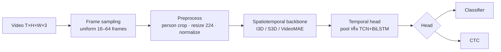
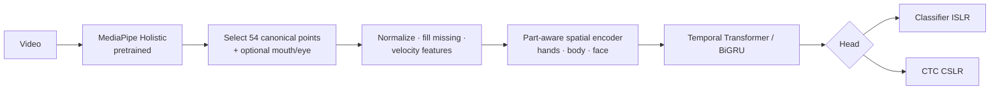
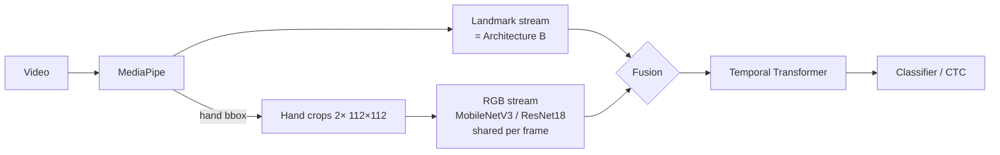
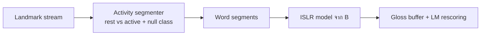
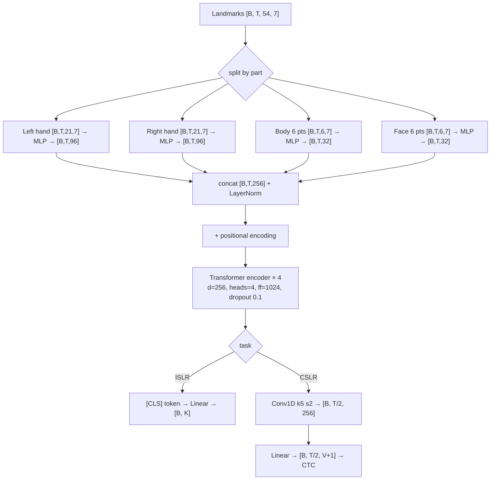
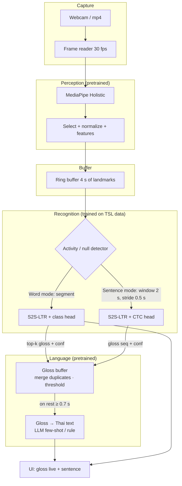

# Technical Design Document: Sign2Say — Thai Sign Language Recognition & Translation

> จัดทำตาม `SystemPipeline&Architecture.md` · 8 พ.ย. 2026
> เอกสารต่อเนื่อง: [Data_Pipeline_Sign2Say.md](Data_Pipeline_Sign2Say.md) (ข้อมูล) · [Experiment_Design_Sign2Say.md](Experiment_Design_Sign2Say.md) (แผนทดลองฉบับเต็ม — แทน §10.3)
> ต่อยอดจาก [Research_Sign_Language_DL.md](Research_Sign_Language_DL.md) และบทเรียนใน Knowledge Base (Ch11 Object Detection, Ch13 Video Processing, Pre-trained CNN & Augmentation, Transformers for CV, Multi-task Learning, Evaluation Metrics)
>
> **ป้ายกำกับ**
> - 📄 **จากงานวิจัย** = ผลหรือเทคนิคที่มีที่มาในบทความ (✅ ตรวจกับตารางต้นฉบับแล้ว / 🟡 แหล่งรอง)
> - 📚 **จากบทเรียน** = แนวคิดที่อยู่ในเอกสารวิชาใน Knowledge Base
> - 🛠 **ข้อเสนอการออกแบบ** = การตัดสินใจของเอกสารนี้ ยังไม่มีผลทดลองยืนยัน ต้องพิสูจน์ด้วย experiment ใน §10.3
>
> **สมมติฐานที่ใช้** (prompt ไม่ได้ระบุ): ภาษาเป้าหมายคือ **ภาษามือไทย (TSL) → ภาษาไทย**, ใช้ webcam ของ laptop, ทรัพยากรฝึกคือ GPU เดียวระดับ 8–16 GB (หรือ Colab), ระยะเวลาโปรเจกต์ราว 1 ภาคการศึกษา

---

## 0. สรุปการตัดสินใจ (อ่านส่วนนี้ก่อน)

| คำถาม | คำตอบ | เหตุผลหลัก |
|---|---|---|
| ทำปัญหาไหน | **A (ISLR) เป็นแกน → B (CSLR) แบบจำกัดคำศัพท์ → C (SLT) แบบ cascade ผ่าน gloss** | ข้อมูลไทยรองรับ A เต็มที่, B บางส่วน, C ไม่มีคู่ (วิดีโอ, ประโยค) ให้ฝึก end-to-end |
| Architecture หลัก | **Landmark-based** (MediaPipe → Part-aware encoder → Temporal Transformer → Classification / CTC head) | ใน ISLR ผล landmark ≈ RGB บน TSL-ONE-S และ AUTSL แต่ถูกกว่ามาก |
| Alternative | **Hybrid: Landmark + RGB hand-crop stream, late → mid fusion** | ใน CSLR บน PHOENIX, RGB ชนะ keypoint ชัดเจน และ fusion ดีที่สุด — เป็นทางอัปเกรดเมื่อ landmark ไม่พอ |
| Translation | **Video → Gloss (CTC) → Thai text (LLM few-shot / rule)** | ไม่มี parallel corpus ไทย; TSL-51 มีลำดับ gloss 62 แบบ (76 แม่แบบ) แต่**ไม่มีคำแปลไทยรายประโยค** → ต้องเขียนคำแปลเอง (ดู Data Pipeline §4) |
| ไม่เลือก | RGB-only (I3D/VideoMAE) เป็นระบบหลัก; End-to-end Video→Text | ต้นทุนสูงโดยไม่มีหลักฐานว่าดีกว่าใน ISLR; SLT end-to-end ไม่มีข้อมูล |

---

## 1. Problem Definition

### 1.1 สามปัญหาที่ต่างกัน (ห้ามรวมเป็นปัญหาเดียว)

| | A. ISLR | B. CSLR | C. SLT |
|---|---|---|---|
| นิยาม | วิดีโอ 1 ท่า → 1 คำ | วิดีโอหลายท่า → ลำดับ gloss ตามลำดับที่ทำ | วิดีโอประโยค → ประโยคภาษาไทยที่ถูกไวยากรณ์ |
| ขอบเขตคำ | รู้ล่วงหน้า | **ไม่รู้** | ไม่รู้ |
| ความสัมพันธ์ input–output | many-to-one | many-to-many, **monotonic** | many-to-many, **non-monotonic** (เรียงคำใหม่, เติมคำ) |
| รูปแบบปัญหา ML | Classification | Sequence labeling | Sequence-to-sequence generation |
| Loss | Cross-Entropy | CTC | Cross-Entropy แบบ autoregressive |
| Metric | Top-1/Top-5, macro-F1 | WER | chrF, BLEU, การประเมินโดยคน |
| Annotation | label ต่อคลิป | gloss sequence ต่อคลิป (ไม่ต้องมี timestamp) | ประโยคแปล (± gloss) |

ตัวอย่างจาก TSL-51 (📄 ✅ README): ประโยค "แม่กินขนมปัง" มี gloss เป็น `ขนมปัง แม่ กิน` → B ต้องได้ `ขนมปัง แม่ กิน`, C ต้องได้ "แม่กินขนมปัง"

### 1.2 ข้อจำกัดของข้อมูลที่กำหนดการออกแบบ

| Dataset | ใช้กับ | ข้อเท็จจริงที่มีผลต่อการออกแบบ (✅ ตรวจจากไฟล์ในเครื่อง) |
|---|---|---|
| TSL-ONE-S | A | 4,152 mp4 (1280×720, 29.97 fps), 184 gloss, 29 signer; skeleton ที่ปล่อยมามีแค่ head 5 จุด (ตา หู จมูก) + มือ → **ไม่มีจุดปาก**; แต่เรามีวิดีโอ raw → **สกัด landmark ใหม่ได้เอง** |
| TSL-51 | A, B, gloss→text | expert มีแค่ landmark CSV 54 จุด (162 ค่า) ไม่มีวิดีโอ; user มีวิดีโอ 640×480 30 fps; ประโยค 252 คลิป/76 แบบจาก **คนเดียว**; มีคลาส `null_act` |
| One-Stage-TFS | ตัวสะกดนิ้ว (optional) | ภาพนิ่ง + bbox VOC 15 คลาส |
| Split | ทั้งหมด | ใช้ `splits/tsl_one_s_signer_indep_fold*.json` (signer-independent) ที่สร้างไว้แล้ว |

🛠 **ผลต่อการออกแบบข้อที่ 1 — Canonical landmark schema**: เพราะ TSL-51 expert มีแค่ 54 จุดชุดนี้และสกัดใหม่ไม่ได้ (ไม่มีวิดีโอ) ขณะที่ TSL-ONE-S สกัดใหม่ได้ → ใช้ **schema เดียวกับ TSL-51 เป็นแกน** (pose index 11–16, face 105/70/300/334/61/291, มือ 21×2) เพื่อให้รวมสอง dataset ได้ และเก็บ **schema ขยาย** (เพิ่มริมฝีปาก/ตา) สำหรับ TSL-ONE-S ไว้ทำ ablation

---

## 2. System Objectives

1. O1 — รู้จำคำภาษามือไทยทีละคำจาก webcam แบบ real-time บน laptop (ไม่บังคับ GPU)
2. O2 — รู้จำลำดับคำในประโยคสั้น (3–6 ท่า) ในชุดคำศัพท์ปิด (closed vocabulary)
3. O3 — แสดงประโยคภาษาไทยที่อ่านเข้าใจได้จาก gloss ที่รู้จำ
4. O4 — วัดผลอย่างเป็นธรรม: signer-independent, รายงาน mean ± std, ทำ ablation ได้
5. O5 — โครงสร้างเปลี่ยนส่วนประกอบได้ (เปลี่ยน encoder/head/เพิ่ม RGB stream) โดยไม่รื้อทั้งระบบ

## 3. Functional Requirements

| ID | Requirement |
|---|---|
| FR1 | รับ input จาก webcam (สด) หรือไฟล์ mp4 |
| FR2 | โหมด Word: ผู้ใช้ทำ 1 ท่า → แสดง top-3 คำพร้อม confidence |
| FR3 | โหมด Sentence: ทำต่อเนื่อง → แสดง gloss ระหว่างทำ และประโยคไทยเมื่อหยุดพัก |
| FR4 | ปฏิเสธ (reject) เมื่อไม่มีการทำภาษามือ หรือ confidence ต่ำกว่า threshold (ใช้คลาส `null`) |
| FR5 | บันทึก landmark + ผลทำนายเพื่อ debug/เก็บข้อมูลเพิ่ม (เมื่อผู้ใช้ยินยอม) |
| FR6 | สคริปต์ประเมินผลแบบ batch ตาม split ที่กำหนด |

## 4. Non-functional Requirements

| ID | Requirement | เป้าหมาย 🛠 |
|---|---|---|
| NFR1 Latency | ผลโหมด Word หลังจบท่า | ≤ 300 ms บน CPU laptop |
| NFR2 Throughput | การสกัด landmark | ≥ 20 fps (ต้องวัดจริงบนเครื่องเป้าหมาย — ยังไม่มีตัวเลข) |
| NFR3 Model size | โมเดล recognition | ≤ 10 M params (ไฟล์ < 40 MB) |
| NFR4 Accuracy | ISLR signer-independent บน TSL-ONE-S | baseline อ้างอิงคือ SPOTER/I3D ~80% แต่ผลนั้นอาจไม่ใช่ signer-independent (ดู research §7.3) → ตั้งเป้าหลังวัด baseline ใหม่ |
| NFR5 Privacy | ประมวลผลบนเครื่อง; เก็บ landmark แทนวิดีโอเป็นค่าเริ่มต้น | |
| NFR6 Robustness | รายงานผลแยกตามแสง/ฉากหลัง/มือถนัด | |
| NFR7 Licensing | ใช้เพื่อการศึกษา non-commercial เท่านั้น (TSL-ONE-S CC-NC, TSL-51 CC BY-NC-SA 4.0) | |

---

## 5. Architecture Alternatives & System Pipeline

### 5.1 Architecture A — RGB-based

| # | Stage | หน้าที่ | Input → Output | เทคนิค / เหตุผล | ทางเลือกอื่น | ข้อดี / ข้อจำกัด | Cost | Failure points |
|---|---|---|---|---|---|---|---|---|
| A1 | Frame extraction | อ่านเฟรม | mp4 → `[T, H, W, 3]` uint8 (BGR→RGB) 📚 Ch13 | OpenCV / decord | torchvision.io | – | I/O-bound | fps ต่างกันระหว่าง dataset (29.97 vs 30 vs 50 ใน web-scraped) |
| A2 | Frame sampling | ทำให้ความยาวคงที่ | `[T,…]` → `[T', …]`, T'=32 | uniform sampling (ISLR); stride 1–2 (CSLR) | random segment, dense sampling | เร็ว / ถ้า T' น้อยเกินจะหลุดท่าสั้น (คลิปสั้นสุด 0.53 s ✅) | ต่ำ | ตัดท่าสั้นทิ้ง |
| A3 | Person crop | ลด background | `[T', H, W, 3]` → `[T', 224, 224, 3]` | crop จาก bbox ของ pose (แบบ TSL-ONE-S 📄) | YOLO person detector 📚 Ch11 | ลด noise / crop ผิดถ้าคนอื่นอยู่ในเฟรม | ต่ำ | มือออกนอกกรอบ |
| A4 | Backbone | สกัด spatiotemporal feature | `[B, 3, T', 224, 224]` → `[B, 1024, T'/8, 7, 7]` | **I3D** (Kinetics pretrained) — baseline ของ TSL-ONE-S 📄 ✅ | S3D, R(2+1)D, Video Swin, VideoMAE | มี pretrained, จับ motion จาก pixel / 12.35M params, ฝึก 21:41 ชม. บน A6000 📄 ✅ | สูง | overfit ฉากหลัง: TSL-ONE-S รายงานช่องว่าง train–val ของ I3D กว้างกว่า SPOTER 📄 ✅ |
| A5 | Temporal head | รวมเวลา | ISLR: global pool → `[B,1024]`; CSLR: spatial pool → `[B,T'',1024]` → TCN+BiLSTM | ตาม VAC/CorrNet 📄 | Transformer | – | กลาง | – |
| A6 | Head | ทำนาย | `[B,K]` หรือ `[T'',B,V+1]` | CE / CTC | – | – | ต่ำ | – |

### 5.2 Architecture B — Landmark-based

| # | Stage | หน้าที่ | Input → Output | เทคนิค / เหตุผล | ทางเลือกอื่น | ข้อดี / ข้อจำกัด | Cost | Failure points |
|---|---|---|---|---|---|---|---|---|
| B1 | Hand/Pose/Face detection | หาตำแหน่งข้อต่อ | `[T,H,W,3]` → pose 33×4, face 468×3, มือ 2×21×3 | **MediaPipe Holistic** — ใช้ใน TSL-51, TSL-ONE-S, TSL10, YouTube-ASL 📄 ✅ | HRNet COCO-WholeBody (133 จุด, ใช้ใน TwoStream/SAM-SLR 📄 ✅), OpenPose, RTMPose | ไม่ต้องฝึก, CPU ได้ / พลาดเมื่อมือเบลอ ซ้อน หรือแตะหน้า | กลาง (ส่วนที่แพงที่สุดของ pipeline B) | มือหาย → `NaN`; สลับซ้าย-ขวา |
| B2 | Landmark selection | ลดมิติ | 543 จุด → N=54 (canonical) หรือ ~75 (extended) | ตรงกับ TSL-51 (✅) เพื่อรวมข้อมูลได้ | ใช้ 543 จุดทั้งหมด (1,662 ค่า แบบ TSL10 📄) | ลด noise จาก face mesh / ตัดข้อมูลสีหน้าส่วนใหญ่ทิ้ง | ต่ำมาก | – |
| B3 | Normalization | ทำให้ไม่ขึ้นกับตำแหน่ง/ขนาดตัว/กล้อง | `[T,N,3]` → `[T,N,3]` | body: ลบจุดกึ่งกลางไหล่, หารความกว้างไหล่; มือ: normalize ใน bbox ของมือเอง (SPOTER 📄 ✅) | z-score ต่อ dataset | ทนต่อระยะกล้อง / พังเมื่อไหล่ถูกบัง | ต่ำมาก | ไหล่ไม่ถูกตรวจ → scale ผิด |
| B4 | Missing handling + features | เติมค่าที่หาย, เพิ่ม motion | `[T,N,3]` → `[T,N,C]`, C=3 (xyz) + 3 (velocity Δ) + 1 (mask) = 7 | linear interpolation ภายใน gap ≤ 5 เฟรม, ที่เหลือ = 0 + mask 🛠 | forward-fill | velocity ช่วยให้โมเดลเห็นการเคลื่อนที่ตรง ๆ | ต่ำมาก | gap ยาวทั้งท่า (มือหายทั้งคลิป) |
| B5 | Spatial encoder | รวม keypoint ในเฟรมเป็นเวกเตอร์ | `[B,T,N,C]` → `[B,T,D]`, D=256 | **Part-aware MLP**: แยก embed มือซ้าย/มือขวา/ลำตัว/หน้า แล้ว concat → linear 🛠 | GCN บนกราฟข้อต่อ (SL-GCN 📄), flatten→linear (SPOTER) | ง่าย, เร็ว / ไม่ใช้โครงสร้างกราฟโดยตรง | ต่ำ | – |
| B6 | Temporal model | เรียนลำดับการเคลื่อนไหว | `[B,T,D]` → `[B,T,D]` | **Transformer encoder 4 ชั้น** + positional encoding 📚 Transformers for CV | BiGRU 2 ชั้น (📚 Ch13; TSL10 ได้ผลดีบนข้อมูลเล็ก 📄), ST-GCN | จับความสัมพันธ์ระยะไกล, ขนานได้ / O(T²), อาจ overfit บนข้อมูลเล็ก → เทียบกับ BiGRU ใน ablation | ต่ำ | – |
| B7 | Head | ทำนาย | ISLR: `[CLS]` → `[B,K]`; CSLR: → `[T/2,B,V+1]` | CE + label smoothing / CTC | – | – | ต่ำมาก | – |

**Landmark เก็บข้อมูลที่จำเป็นได้ครบไหม?** (คำถามบังคับใน prompt)

| องค์ประกอบของภาษามือ | Landmark เก็บได้? | หลักฐาน |
|---|---|---|
| รูปมือ (handshape) | **ส่วนใหญ่ได้** — 21 จุด/มือ บอกการงอนิ้ว; แต่พลาดเมื่อนิ้วซ้อน/บัง/เบลอ | 📄 ✅ TwoStream: keypoint ผิดพลาดจาก motion blur; SAM-SLR: ใช้แค่ 10 จุด/มือก็ได้ 95% บน AUTSL |
| ตำแหน่ง (location) | ได้ดี — ตำแหน่งมือเทียบกับลำตัว/หน้า | |
| การเคลื่อนที่ (movement) | ได้ดี — trajectory + velocity | |
| ทิศของฝ่ามือ (orientation) | บางส่วน — อนุมานจาก z ของ 21 จุด ซึ่งค่า z จากกล้องเดียวไม่แม่น 💭 | |
| การสัมผัส (มือ-มือ, มือ-หน้า) | **อ่อน** — MediaPipe มักพลาดเมื่อมือแตะหน้าหรือทับกัน 💭 | |
| สีหน้า / ปาก (non-manual) | **ขึ้นกับจำนวนจุดหน้า**: schema 6 จุดของ TSL-51 เก็บได้น้อยมาก | 📄 ✅ TwoStream (PHOENIX-2014T, keypoint-only): เพิ่มจุดปาก 10 จุดทำ WER ลดจาก 36.88 → 28.20, เพิ่มหน้าอีก 16 จุด → 27.19 |
| ความเข้ม/จังหวะ | บางส่วน — ผ่าน velocity | |

สรุป: **สำหรับ ISLR landmark พอ** (📄 ✅ AUTSL: SL-GCN 95.45% vs RGB 3D CNN 94.77%; TSL-ONE-S: SPOTER 80.83% vs I3D 79.69%) **แต่สำหรับ CSLR/SLT ยังไม่พอ** (📄 ✅ PHOENIX-2014 test WER: keypoint-only 28.00 vs video-only 23.32 vs two-stream 18.79)

### 5.3 Architecture C — Hybrid Multimodal

| # | Stage | Input → Output | เทคนิค / เหตุผล | ทางเลือกอื่น | Cost | Failure points |
|---|---|---|---|---|---|---|
| C1 | Landmark stream | ตาม B → `[B,T,D_l]` | ใช้ซ้ำ | – | ต่ำ | – |
| C2 | Hand crop | ใช้ bbox จาก landmark มือ (+margin 20%) → `[B,T,2,3,112,112]` 🛠 | ได้ข้อมูลรูปมือละเอียด โดยไม่ต้องประมวลผลทั้งเฟรม; ใช้ landmark ที่มีอยู่แล้วแทน detector แยก 📚 Ch11 (แนวคิด ROI เหมือน YOLO→CNN ในงาน TFS 📄 ✅) | full-frame RGB (แบบ TwoStream) | ต่ำ | มือหาย → crop ไม่ได้ → ต้องมี mask |
| C3 | RGB encoder | `[B·T·2,3,112,112]` → `[B,T,2·512]` → linear → `[B,T,D_r]` | 2D CNN pretrained ImageNet 📚 Pre-trained CNN; freeze ช่วงแรก | I3D บน crop, VideoMAE | กลาง | domain shift ของ ImageNet → SLRT รายงานว่า feature ที่ pretrain บน sign data ดีกว่า 📄 ✅ |
| C4 | Fusion | ดู §5.4 | | | | |
| C5 | Temporal + head | `[B,T,D]` → head | เหมือน B | | ต่ำ | |

### 5.4 ควร Fusion ที่ไหน และทำไม

| แบบ | ทำที่ | กลไก | ข้อดี | ข้อเสีย | ใช้เมื่อ |
|---|---|---|---|---|---|
| **Early** | ก่อน temporal model (ต่อเฟรม) | concat `[D_l ; D_r]` → linear | ง่ายที่สุด, temporal model เห็นทั้งสองพร้อมกัน | stream ที่แรงกว่าอาจกลบอีก stream; scale ต่างกัน | มี alignment ระดับเฟรมสมบูรณ์ (ที่นี่มี: ทั้งสองมาจากเฟรมเดียวกัน) |
| **Late** | หลัง head | เฉลี่ย/ถ่วงน้ำหนัก logits ของแต่ละโมเดล | ฝึกแยก, debug ง่าย, ใช้ได้ทันที — SAM-SLR ใช้แบบนี้ (ensemble) 📄 ✅ | ไม่เรียนปฏิสัมพันธ์ระหว่าง modality; ต้นทุนรวมสองโมเดล | ขั้นแรกของการทดลอง |
| **Mid / Cross-attention** | ระหว่างชั้นของ temporal encoder | landmark tokens เป็น Q, RGB tokens เป็น K/V (หรือสองทาง) | เรียนว่าเมื่อไรควรดูภาพ (เช่น ตอนมือซ้อนกัน) — แนวคิดใกล้ bidirectional lateral connection ของ TwoStream ที่ลด WER 1.44 บน dev 📄 ✅ | ซับซ้อน, ต้องการข้อมูลมากกว่า | หลัง late fusion พิสูจน์แล้วว่า RGB ช่วย |

🛠 **ลำดับที่แนะนำ**: Late fusion (พิสูจน์ว่า RGB stream มีข้อมูลเสริม) → Early concat → Cross-attention ถ้าข้อมูลพอ — ถ้า late fusion ไม่ดีขึ้นอย่างมีนัยสำคัญ ไม่ต้องทำต่อ

### 5.5 Architecture D (เสนอเพิ่ม) — Decoupled Segment-then-Classify

สำหรับ CSLR เมื่อข้อมูลประโยคมีน้อย (TSL-51: 252 คลิปจากคนเดียว):

- ใช้หลักเดียวกับการตัดคลิปอัตโนมัติของ TSL-ONE-S (มือวางบนตัก = พัก, T_A/T_R) 📄 ✅
- ข้อดี: ใช้ ISLR ที่ฝึกจากข้อมูลคำเดี่ยวจำนวนมาก ไม่ต้องมีข้อมูลประโยคเยอะ
- ข้อจำกัด: ผู้ใช้จริงไม่ได้หยุดพักระหว่างคำ → ใช้ได้ดีเมื่อผู้ใช้เว้นจังหวะ (TSL-51 มีประโยคแบบ `with_space` 24 คลิป vs `no_space` 228 คลิป ✅ — ใช้ทดสอบข้อจำกัดนี้ได้พอดี)
- 🛠 ใช้เป็น **baseline ของ B (CSLR)** เทียบกับ CTC

---

## 6. Model Architecture

### 6.1 การเลือกแต่ละโมเดล (เฉพาะที่มีเหตุผล)

| โมเดล | หน้าที่ | Tensor in → out | ใช้ในระบบนี้? | เหตุผล | ทางเลือกที่ประหยัดกว่า |
|---|---|---|---|---|---|
| **MediaPipe Holistic** | pose/hand/face estimator | `[H,W,3]` → 543 จุด | ✅ หลัก | dataset ไทยทุกชุดใช้ → schema ตรงกัน, รันบน CPU | MediaPipe Hands อย่างเดียว (ไม่มีหน้า) |
| ResNet18 | 2D backbone ต่อเฟรม/ต่อ crop | `[N,3,112,112]` → `[N,512]` | ✅ ใน C | มาตรฐานใน VAC/CorrNet/GFSLT 📄 | **MobileNetV3-Small** (ถูกกว่าหลายเท่า) |
| EfficientNet | 2D backbone | – | ⚪ ไม่ใช้ | SLRT รายงานว่า EfficientNet (ImageNet) แย่กว่า feature ที่ pretrain บน sign 📄 ✅ — ไม่มีเหตุผลเฉพาะให้เลือก | – |
| MobileNetV2/V3 | 2D backbone เบา | `[N,3,112,112]` → `[N,576–1280]` | ✅ ทางเลือก C บน CPU | งาน TFS ไทยได้ผลดีกับข้อมูลน้อย (MobileNetV2 ≥ 93.86% ที่ train 30%) 📄 ✅ | – |
| I3D | 3D CNN | `[B,3,T,224,224]` → `[B,1024]` | ✅ เป็น **baseline ของ A** เท่านั้น | ทำให้เทียบกับ TSL-ONE-S ได้ตรง 📄 | S3D |
| Video Swin / VideoMAE | Video Transformer | `[B,3,16,224,224]` → tokens | ⚪ ไม่ใช้ในแผนหลัก | ต้นทุน pretrain/fine-tune สูง และไม่พบหลักฐานบนข้อมูลไทยว่าคุ้ม | – |
| LSTM/BiLSTM/GRU | temporal | `[B,T,D]` → `[B,T,D']` | ✅ ใน ablation | 📚 Ch13; TSL10 ได้ผลดีมากบน 10 คำ 📄 | GRU (พารามิเตอร์น้อยกว่า LSTM) |
| TCN (1D conv) | temporal ระยะสั้น + ลดความยาว | `[B,D,T]` → `[B,D,T/2]` | ✅ ก่อน CTC | ใช้ใน VAC/CorrNet/Lata thesis 📄 | – |
| **Transformer encoder** | temporal ระยะยาว | `[B,T,D]` → `[B,T,D]` | ✅ หลัก | SPOTER (pose + Transformer) ≈ I3D บน TSL-ONE-S ด้วย params ราวครึ่งเดียว 📄 ✅ | BiGRU |
| ST-GCN / SL-GCN | spatio-temporal graph | `[B,C,T,V,M]` → `[B,D]` | ⚪ optional (ablation) | SL-GCN 95.45% บน AUTSL 📄 ✅ แต่ซับซ้อนกว่า | Part-aware MLP |
| Classification head | ISLR | `[B,D]` → `[B,K]` | ✅ | | |
| CTC head | CSLR | `[B,T',D]` → `[T',B,V+1]` | ✅ | 📄 ทุกงาน CSLR ที่อ้าง | |
| Transformer decoder / seq2seq | SLT | – | ⚪ ไม่ฝึกเอง | ไม่มีคู่ข้อมูลไทย | ใช้ LLM สำเร็จรูปแทน |
| Multi-task | แชร์ encoder หลายงาน | encoder → {class, CTC} | ✅ (ISLR + CSLR ใช้ encoder เดียว) | 📚 Multi-task Learning: shared feature extractor + task-specific heads ช่วยเมื่อข้อมูลจำกัดและงานเกี่ยวข้องกัน | ฝึกแยก |

### 6.2 โมเดลที่เสนอ (🛠): **S2S-LTR** (Landmark Temporal Recognizer)

- ประมาณขนาด: Transformer 4 ชั้นที่ d=256, ff=1024 ≈ 4 × (4·256² + 2·256·1024) ≈ 3.1M params + embedding/heads < 0.5M → **~3.5M params** (คำนวณจากสูตร) — เล็กกว่า SPOTER (5.92M 📄 ✅) และ I3D (12.35M 📄 ✅)
- แยก embed ตามส่วนของร่างกาย เพราะมือมีข้อมูลมากที่สุด (ให้ dimension มากกว่า) และให้ ablation "ตัดหน้าออก" ทำได้ง่ายโดยไม่เปลี่ยนโครงสร้าง

---

## 7. Data Flow Diagram (ระบบใช้งานจริง)

1. กล้องให้เฟรม → MediaPipe สกัด landmark ต่อเฟรม (ส่วนที่ใช้เวลามากที่สุด)
2. landmark ที่ normalize แล้วเข้า ring buffer (ไม่เก็บวิดีโอ → NFR5)
3. Activity detector ใช้ความเร็วของข้อมือ + ตำแหน่งมือเทียบสะโพก/ตัก (แบบ TSL-ONE-S) หรือคลาส `null` ของโมเดล
4. Word mode: ส่งทั้ง segment ให้ head classification → top-3
5. Sentence mode: sliding window + CTC greedy decode → รวมผลข้าม window (ตัดตัวซ้ำที่ซ้อนกัน)
6. เมื่อผู้ใช้พักนาน → ส่ง gloss (พร้อม confidence) ให้ gloss→text

---

## 8. Tensor Shape Specification

**สัญลักษณ์**: B = batch, T = จำนวนเฟรม, N = จำนวน keypoint, C = feature ต่อ keypoint, D = hidden dim, K = จำนวนคลาสคำ, V = จำนวน gloss, L = ความยาวประโยคที่ทำนาย, H/W = สูง/กว้าง

### 8.1 Landmark pipeline (ระบบหลัก)

| Stage | Shape | ความหมาย / หมายเหตุ |
|---|---|---|
| Raw video | `[T, H, W, 3]` = `[≈58, 720, 1280, 3]` | TSL-ONE-S เฉลี่ย 1.94 s × 29.97 fps ✅ |
| MediaPipe output | pose `[T,33,4]`, face `[T,468,3]`, hands `[T,2,21,3]` | 4 = x,y,z,visibility |
| Canonical select | `[T, 54, 3]` | 6 pose + 6 face + 42 hand (= 162 ค่า แบบ TSL-51 ✅) |
| Resample (ISLR) | `[64, 54, 3]` | interpolate ให้ T=64; CSLR ไม่ resample |
| + velocity + mask | `[64, 54, 7]` | xyz, Δxyz, valid |
| Batch | `[B, T, N, C]` = `[32, 64, 54, 7]` | |
| Part MLPs + concat | `[32, 64, 256]` | ดู §6.2 |
| + [CLS] | `[32, 65, 256]` | ISLR เท่านั้น |
| Transformer | `[32, 65, 256]` | attention mask สำหรับ padding |
| ISLR head | `[32, K]` = `[32, 184]` | TSL-ONE-S |
| CSLR: Conv1D s2 | `[B, T/2, 256]` เช่น `[8, 150, 256]` | ประโยค TSL-51 ~301 เฟรม ✅ |
| CTC logits | `[150, 8, V+1]` = `[150, 8, 53]` | V = 51 คำ + null (52) + blank ✅; layout `[T, B, V+1]` ตาม `nn.CTCLoss` |
| CTC decode | list ความยาว L | เช่น `ขนมปัง แม่ กิน` |

> 💡 ข้อกำหนด CTC: T/2 = 150 ≥ ความยาว gloss สูงสุด (6) มากพอ — ถ้าลดเวลา ×4 ก็ยังพอ (75)

### 8.2 RGB stream (Architecture C)

| Stage | Shape |
|---|---|
| Hand crops | `[B, T, 2, 3, 112, 112]` |
| reshape | `[B·T·2, 3, 112, 112]` |
| ResNet18 / MobileNetV3 (GAP) | `[B·T·2, 512]` (ResNet18) |
| reshape + concat มือ | `[B, T, 1024]` → Linear → `[B, T, 128]` |
| Early fusion กับ landmark | `[B, T, 256 + 128]` → Linear → `[B, T, 256]` |

### 8.3 RGB baseline (Architecture A — I3D)

| Stage | Shape |
|---|---|
| Sampled clip | `[B, T, H, W, C]` = `[16, 64, 224, 224, 3]` |
| permute (Conv3d ต้องการ channel-first 📚 Ch13) | `[16, 3, 64, 224, 224]` |
| I3D final conv | `[16, 1024, 8, 7, 7]` |
| Global avg pool | `[16, 1024]` |
| Logits | `[16, 184]` |

---

## 9. Recognition & Translation Strategy

| แนวทาง | Annotation ที่ต้องมี | Dataset ลักษณะ | ความยากในการฝึก | สำหรับ TSL ตอนนี้ |
|---|---|---|---|---|
| 1. Video → Classification | label ต่อคลิป | คลิปคำเดี่ยว ตัดขอบแล้ว | ต่ำ | ✅ TSL-ONE-S, TSL-51 |
| 2. Video → Gloss (CTC) | gloss sequence ต่อประโยค | วิดีโอประโยค + gloss | กลาง: CTC converge ช้า, feature extractor ฝึกไม่พอ (VAC 📄) | 🟡 TSL-51 252 คลิป/คนเดียว — ต้องเสริมด้วยประโยคสังเคราะห์ |
| 3. Video → Gloss → Text | (2) + คู่ gloss–text | (2) + corpus gloss–text | กลาง; error ส่งต่อระหว่าง stage | 🟡 ทำได้หลังเขียนคำแปลไทยเอง: TSL-51 ให้ลำดับ gloss 62 แบบ + ตารางโครงสร้าง 13 กลุ่มใน README เท่านั้น ✅ |
| 4. Video → Text (end-to-end) | คู่ (วิดีโอ, ประโยค) จำนวนมาก | parallel corpus | สูง; ข้อมูลหลายพันคู่ขึ้นไป (PHOENIX14T ~7K คู่ 📄 ✅) | ❌ ไม่มีข้อมูลไทย |
| 5. Multi-task (gloss + text) | ทั้ง gloss และ text | เหมือน (4) + gloss | สูง | ❌ ด้วยเหตุผลเดียวกัน |

**หลักฐานที่ใช้ตัดสินใจ**:
- 📄 ✅ SLRT (PHOENIX14T): Gloss2Text จาก gloss จริงได้ BLEU-4 24.54 — แปลว่าในโดเมนแคบ gloss มีข้อมูลพอสำหรับประโยคที่ใช้ได้
- 📄 ✅ ในงานที่มีข้อมูลพอ end-to-end ชนะ cascade (TwoStream-SLT Sign2Text 28.95 vs Sign2Gloss2Text 26.71) — แต่เงื่อนไขนั้น (≥7K คู่) เราไม่มี
- 📄 ✅ Müller et al. ACL 2023: gloss สูญเสียข้อมูลบางส่วน → ต้องระบุเป็นข้อจำกัด

🛠 **เลือก (1) + (2) + (3)**: ฝึก encoder ร่วม (multi-task ระหว่าง classification กับ CTC — ข้อมูลคำเดี่ยวช่วยให้ encoder เรียนท่าได้ก่อน) แล้วใช้ cascade gloss → text

**Gloss → Thai text** — ลำดับทางเลือก:
1. **Rule/template**: map ลำดับ gloss → แม่แบบประโยคไทยตาม 13 กลุ่มไวยากรณ์ใน README ของ TSL-51 (ต้องเขียนแม่แบบไทยเอง; แม่นใน closed domain, ไม่ hallucinate)
2. **LLM few-shot**: ใส่ตัวอย่าง gloss→ประโยค 10–20 คู่ใน prompt + ส่ง top-k gloss พร้อม confidence เพื่อให้เลือกคำที่สมเหตุสมผล
3. ประเมินด้วย chrF (ไม่ต้องตัดคำไทย) + BLEU (ระบุ tokenizer) + ตรวจโดยผู้ใช้ภาษามือ

---

## 10. Architecture Comparison & Model Selection Justification

### 10.1 เกณฑ์การให้คะแนน (1 = อ่อน, 2 = ปานกลาง, 3 = ดี)

ให้คะแนนจาก **หลักฐานเชิงทดลองที่อ้างได้** ก่อน ถ้าไม่มีให้ใช้ **คุณสมบัติที่คำนวณได้** (ขนาด input, จำนวนพารามิเตอร์) และระบุว่าเป็นการให้เหตุผล (💭)

| Criteria | RGB-based | Landmark-based | Hybrid | เหตุผล / หลักฐาน |
|---|---|---|---|---|
| Information captured | 3 | 2 | 3 | RGB มีทุกพิกเซล; landmark เก็บเฉพาะจุดที่เลือก |
| Spatial understanding | 2 | 2 | 3 | RGB เห็นรูปมือละเอียดแต่ปนฉากหลัง; landmark ไม่มีฉากหลังแต่ขึ้นกับ estimator; 📄 ✅ TSL-ONE-S: I3D overfit มากกว่า |
| Temporal understanding | 2 | 3 | 3 | landmark + velocity ให้ trajectory ตรง ๆ; 3D CNN จับ motion ระยะสั้น (receptive field ~ไม่กี่สิบเฟรม) 💭 |
| Facial expression | 3 | 1 (6 จุด) / 2 (ขยาย) | 3 | 📄 ✅ TwoStream: จุดปาก/หน้าลด WER ของ keypoint stream จาก 36.88 → 27.19 แต่ยังแย่กว่า video stream |
| Hand articulation | 2–3 | 2 | 3 | 📄 ✅ ISLR: ใกล้กัน (AUTSL 94.77 vs 95.45; TSL-ONE-S 79.69 vs 80.83) |
| Computational cost | 1 | 3 | 2 | input ต่างกัน ~1,000 เท่า (64×224×224×3 vs 64×162); 📄 ✅ train 21:41 vs 1:48 ชม. (คนละ GPU) |
| Data requirements | 1 | 3 | 2 | RGB ต้อง pretrain + ข้อมูลหลากหลายฉากหลัง 💭 |
| Training complexity | 2 | 3 | 1 | Hybrid ต้องจูน 2 streams + fusion |
| Real-time potential | 1 | 3 | 2 | landmark model < 5M params รันบน CPU ได้; hybrid ใช้ hand crop เล็ก |
| Translation potential | 3 | 2 | 3 | 📄 ✅ CSLR PHOENIX test WER: video 23.32 / keypoint 28.00 / two-stream 18.79 |
| **รวม** | **20–21** | **24–25** | **25** | |

> ⚠️ คะแนนรวมไม่ใช่การบอกว่าตัวไหน "ดีที่สุด" — Hybrid กับ Landmark ได้ใกล้กัน แต่ Hybrid ได้คะแนนจากเกณฑ์ด้าน **ความแม่น** ส่วน Landmark ได้จากเกณฑ์ด้าน **ต้นทุน/ความเป็นไปได้** ซึ่งเป็นข้อจำกัดหลักของโปรเจกต์นี้

### 10.2 Final Architecture Recommendation

**เลือก: Architecture B (Landmark-based, S2S-LTR) + cascade gloss→text**

- **ทำไมเลือก**: (1) ใน ISLR — งานหลักของเรา — ไม่มีหลักฐานว่า RGB ดีกว่า landmark (TSL-ONE-S, AUTSL) (2) ต้นทุนต่ำพอจะทำ signer-independent 10-fold และ ablation ได้ครบภายในเวลาโปรเจกต์ (3) schema ตรงกับ TSL-51 ทำให้รวมข้อมูลได้ (4) รันบน CPU ตาม NFR1–3
- **ทำไมไม่เลือก A**: ต้นทุนสูง (ฝึก I3D ~12× นานกว่า SPOTER บน TSL-ONE-S 📄 ✅) และ overfit ฉากหลังมากกว่า โดยไม่ได้ความแม่นเพิ่มใน ISLR — ใช้เป็น baseline อย่างเดียว
- **ทำไมไม่เลือก C เป็นหลัก**: ประโยชน์ชัดเจนของ RGB อยู่ที่ CSLR/SLT ซึ่งข้อมูลไทยของเรายังเล็กเกินจะได้ประโยชน์นั้น; ความซับซ้อนเพิ่มโดยยังไม่รู้ว่าคุ้มบน TSL

**Alternative: Architecture C (Hybrid, landmark + hand-crop RGB, late → mid fusion)** — เปิดใช้เมื่อ (ก) confusion matrix ชี้ว่าคำที่ผิดเป็นคู่ที่ต่างกันแค่รูปมือ/สีหน้า หรือ (ข) ทำ CSLR ด้วยข้อมูลมากขึ้น

| องค์ประกอบ | สถานะ | Pretrained / Train เอง |
|---|---|---|
| MediaPipe Holistic | **จำเป็น** | Pretrained (ไม่ฝึก) |
| Normalization + velocity | **จำเป็น** | กฎ |
| Part-aware encoder + Transformer | **จำเป็น** | **Train เอง** บน TSL-ONE-S + TSL-51 |
| Classification head | **จำเป็น** | Train เอง |
| Null/activity detector | **จำเป็น** สำหรับใช้งานจริง | Train เอง (คลาส `null_act` ของ TSL-51 ✅) + กฎ |
| CTC head | Optional (ขั้น B) | Train เอง |
| Extended face points | Optional (ablation) | – |
| RGB hand-crop stream | Optional (Alternative) | Backbone pretrained ImageNet, fine-tune ชั้นบน |
| Gloss→text | Optional (ขั้น C) | Pretrained LLM / rule |
| Cross-lingual pretrain (WLASL/Google ISLR landmarks) | Optional (ทดลอง) | Pretrained บนภาษาอื่น แล้ว fine-tune TSL — ต้องรายงานผลแยกว่าเป็นผลบน TSL เท่านั้น |

**ข้อจำกัดที่ต้องยอมรับ**
- สีหน้า/ไวยากรณ์ non-manual แทบไม่ถูกใช้ใน schema 54 จุด
- CSLR วัด signer-independent ไม่ได้ (ประโยคมีผู้แสดงคนเดียว) → รายงานผลแบบแยกตามรูปแบบประโยคแทน และระบุข้อจำกัดชัดเจน
- Translation จำกัดอยู่ใน closed domain ของ 76 แม่แบบ (62 ลำดับ gloss) และคำแปลอ้างอิงเป็นของที่เราเขียนเอง
- ผลขึ้นกับความแม่นของ MediaPipe (มือเบลอ/ซ้อน)

**ถ้าทรัพยากรไม่พอ — ลดตามลำดับนี้**
1. Transformer → **BiGRU 2 ชั้น** (เล็กกว่า, ข้อมูลน้อยก็ฝึกได้)
2. 10-fold → 5-fold หรือ fold 0 อย่างเดียว (รายงานว่าใช้ fold เดียว)
3. ตัด velocity/mask เหลือ xyz
4. ตัด CTC และ translation → เหลือ ISLR + null class (ยังเป็นระบบใช้งานได้)
5. Baseline A (I3D) ใช้ตัวเลขจากบทความแทนการฝึกเอง (พร้อมระบุว่า protocol ต่างกัน)

### 10.3 แผนทดลองที่ใช้พิสูจน์การออกแบบ (🛠 ทุกข้อยังไม่มีผล)

| Exp | เปรียบเทียบ | คงที่ | ตอบคำถาม |
|---|---|---|---|
| E1 | Logistic regression บนสถิติ landmark vs BiGRU vs S2S-LTR vs SPOTER | split, schema, epoch budget | temporal model ช่วยเท่าไร |
| E2 | S2S-LTR: 54 จุด vs extended face (TSL-ONE-S re-extract) | ทุกอย่าง | จุดหน้า/ปากช่วย TSL ไหม |
| E3 | ± velocity, ± part-aware embedding | ทุกอย่าง | feature design |
| E4 | ฝึก TSL-ONE-S อย่างเดียว vs + TSL-51 (schema ร่วม, **head แยก** เพราะคำศัพท์สองชุดไม่ซ้ำกัน ✅) | test ของแต่ละ dataset แยกกัน | การฝึก encoder ร่วมช่วยไหม |
| E5 | Landmark vs Late-fusion hybrid vs I3D | split เดียวกัน | RGB คุ้มไหมบน TSL |
| E6 | CSLR: segment-then-classify (D) vs CTC | TSL-51 sentences, แยก `with_space`/`no_space` | CTC จำเป็นไหม |
| E7 | gloss→text: rule vs LLM few-shot | gloss จริง vs gloss ที่ทำนาย | error propagation |

ทุก experiment: 3 seeds × (10 หรือ 5) folds, รายงาน mean ± std, ทดสอบนัยสำคัญด้วย paired test บนผลต่อคลิป (📚 Evaluation Metrics: ใช้ macro-F1 คู่กับ accuracy)

---

## 11. Computational Requirements

| ส่วน | Params | ทรัพยากรฝึก | ทรัพยากรใช้งาน | ที่มา |
|---|---|---|---|---|
| MediaPipe Holistic | – (pretrained) | สกัด landmark ครั้งเดียว: 4,152 คลิป × ~58 เฟรม ≈ 240K เฟรม (TSL-ONE-S) | CPU; fps ต้องวัดบนเครื่องเป้าหมาย ❓ | คำนวณจากข้อมูล ✅ |
| S2S-LTR | ~3.5M | GPU 4–8 GB หรือ Colab T4; batch 32 × 64 เฟรม | CPU ได้ | คำนวณจากสูตร 🛠 |
| SPOTER (baseline) | 5.92M | 1:48 ชม. บน RTX 2070 (TSL-ONE-S) | CPU ได้ | 📄 ✅ |
| I3D (baseline) | 12.35M | 21:41 ชม. บน RTX A6000 (TSL-ONE-S) | GPU | 📄 ✅ |
| RGB hand-crop stream | ResNet18 ~11.7M / MobileNetV3-S ~2.5M | GPU 12–16 GB ถ้า fine-tune | GPU แนะนำ; MobileNet ใช้ CPU ได้ช้า | ค่ามาตรฐานจากบทความต้นฉบับของแต่ละโมเดล (ไม่ได้ตรวจซ้ำรอบนี้) |
| พื้นที่จัดเก็บ | – | landmark ทั้ง TSL-ONE-S ≈ 240K × 162 × 4 bytes ≈ 160 MB (float32) vs วิดีโอ 1.5 GB ✅ | – | คำนวณ |

---

## 12. Risk Analysis

| Risk | โอกาส | ผลกระทบ | การลดความเสี่ยง |
|---|---|---|---|
| R1 MediaPipe พลาดเมื่อมือเบลอ/ซ้อน/แตะหน้า | สูง | กลาง–สูง | mask + interpolation; วัดอัตรามือหายต่อคำ; ถ้ากระจุกในบางคำ → เปิด Alternative C |
| R2 ผล signer-independent ต่ำกว่าบทความมาก | สูง | กลาง (เป็นข้อค้นพบได้) | รายงานทั้งสอง protocol; augmentation ด้าน signer (scale, rotation, speed) |
| R3 Data leakage (augment copies, signer) | กลาง | สูง | ใช้ split ที่สร้างแล้ว; group TSL-51 ตาม `original_video_id` |
| R4 Schema ไม่ตรงข้าม dataset (fps, ความละเอียด, MediaPipe version) | กลาง | กลาง | resample เวลาเป็นวินาทีแทนเฟรม; สกัด TSL-ONE-S ใหม่ด้วย config เดียวกับ TSL-51 (confidence 0.5, model_complexity 1 ✅) |
| R5 CSLR overfit คนเดียว | สูง | กลาง | ประโยคสังเคราะห์จากคำเดี่ยว; เก็บข้อมูลเพิ่ม; ระบุข้อจำกัด |
| R6 LLM hallucination ใน gloss→text | กลาง | สูง (ความหมายผิด) | rule/template ก่อน; จำกัด LLM ให้ใช้เฉพาะคำจาก gloss; แสดง gloss คู่กับประโยคเสมอ |
| R7 Domain shift กล้อง/แสงจริง | สูง | กลาง | ทดสอบกับผู้ใช้ใหม่จริง; landmark ลดผลจากฉากหลังได้บางส่วน |
| R8 License | ต่ำ | สูง | ใช้เพื่อการศึกษาเท่านั้น; ไม่แจกจ่ายวิดีโอต้นฉบับ |
| R9 ภาษามือมีความหลากหลายระดับภูมิภาค (TSL-ONE-S มาจาก 9 โรงเรียน 5 ภูมิภาค ✅) | กลาง | กลาง | รายงานผลแยกตามภูมิภาค/โรงเรียน |

---

## 13. Roadmap สั้น (🛠)

| ระยะ | งาน | ผลลัพธ์ |
|---|---|---|
| 1 | สกัด landmark TSL-ONE-S ใหม่ด้วย schema 54 จุด + extended; รวมกับ TSL-51 | dataset landmark รูปแบบเดียว |
| 2 | E1 (baselines) บน `splits/` | ตาราง baseline signer-independent |
| 3 | S2S-LTR + E2–E4 | โมเดลหลัก + ablation |
| 4 | Null detector + demo webcam (Word mode) | MVP ใช้งานได้ |
| 5 | CTC + E6, gloss→text + E7 | Sentence mode |
| 6 | (ถ้ามีเวลา) E5 hybrid | ตอบว่า RGB คุ้มไหม |

---

## อ้างอิงเพิ่มเติมจากรายงานวิจัย

รายการอ้างอิงเต็มอยู่ใน [Research_Sign_Language_DL.md §12](Research_Sign_Language_DL.md) — ที่ใช้ตัดสินใจในเอกสารนี้โดยตรง:

- Chen et al., *Two-Stream Network for SLR and SLT*, NeurIPS 2022 — ablation video/keypoint/fusion และจุดหน้า-ปาก (Table 5a, Table 7) https://arxiv.org/abs/2211.01367
- Jiang et al., *Skeleton Aware Multi-modal SLR*, CVPRW 2021 — ผลแยก modality บน AUTSL (Table 6–7) https://arxiv.org/abs/2103.08833
- Chalotonpised et al., *TSL-ONE-S*, IEEE Access 2026 — I3D vs SPOTER, การตัดคลิป, เวลาฝึก DOI 10.1109/ACCESS.2026.3670970
- Boháček & Hrúz, *SPOTER*, WACVW 2022 — normalization ของ landmark
- Camgöz et al., *Sign Language Transformers*, CVPR 2020 — Gloss2Text, ผลของ feature ImageNet vs sign-pretrained https://arxiv.org/abs/2003.13830
- Min et al., *VAC*, ICCV 2021; Hu et al., *CorrNet*, CVPR 2023 — โครง CNN + TCN + BiLSTM + CTC
- Müller et al., ACL 2023 — ข้อจำกัดของ gloss
- Viriyaroj, *TSL-51* (Hugging Face) — schema landmark 54 จุด, `null_act`, แม่แบบประโยค
- Thammasit & Sompong, วารสาร IT มจพ. 2026 — LSTM/GRU บน MediaPipe 1,662 ค่า
- Lata, PhD thesis 2023; Lata & Surinta 2022 — YOLO → CNN สำหรับตัวสะกดนิ้ว, CTC บนประโยคไทย
